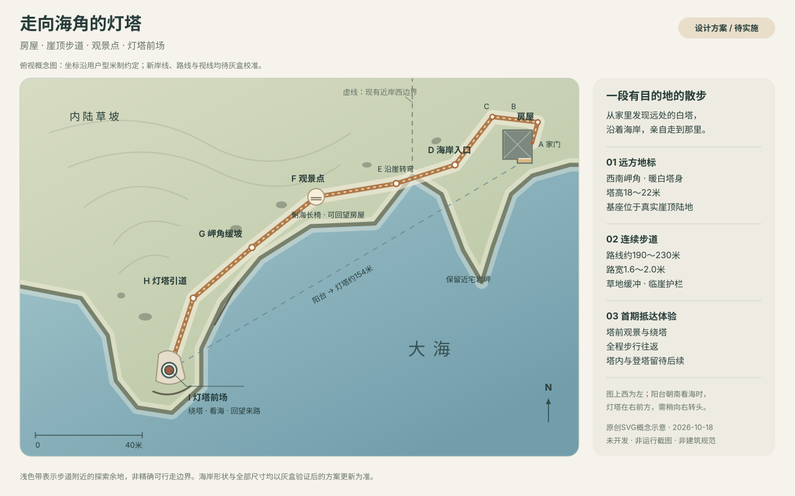

# 悬崖灯塔与沿海步道方案

| 项目 | 内容 |
| --- | --- |
| 状态 | 实施中：阶段A/B/C已完成；阶段D待实施 |
| 创建 / 更新日期 | 2026-10-18 / 2026-10-18 |
| 代码基线 | 规划基线 `665a9e0`；阶段A实施基线 `2169624`，阶段B实施基线 `8110fe7`，阶段C实施基线 `6d7e644`；原海岸v1冻结点为 `d1ae3a1` |
| 用户目标 | 在远处悬崖边增加一座灯塔，从现有房屋沿路抵达；新增小电驴方案缩短赶路时间 |
| 相关依据 | [资源原则](../resource-optimization-principles.md)、[海岸外景](2026-10-17-coastal-cliff-exterior.md)、[第一人称与跳跃](2026-10-17-first-person-jump.md)、[户型实施](2026-10-16-house-layout-implementation.md)、[地图方案](2026-10-16-house-floor-plan.md)、[海岸v1基线](../reuse/coastal-cliff-v1.md) |

## 1. 背景与现状

房屋已有八房、面海南阳台、连续三维悬崖与动态海面，适合增加一个可以亲自走到的远方地标。目标体验是：在家中发现灯塔，出门沿海散步，途中看见不同角度的海岸，到塔前回望来路与房屋，再自行返回。

初始规划时，室外是观看用外景，尚不支持正常步行。以下为A/B实施前的历史现状：

- [HouseLayout](../../src/examples/HouseLayout.ts)采用平面米制坐标，北为 `-y`、南/海侧为 `+y`、东为 `+x`、西为 `-x`，1米=5世界单位。入户门在东墙 `(10.8, 4.1～5.2)`，阳台朝南，室内地坪不迁移。
- [HouseWalking](../../src/examples/HouseWalking.ts)把玩家限制在房屋L形范围，[HouseArchitecture](../../src/examples/HouseArchitecture.ts)在入户门外设置不可见边界。仅移除两者不能使室外可玩。
- [RoomExterior](../../src/examples/RoomExterior.ts)目前统一关闭外景碰撞与拾取；[HouseJump](../../src/examples/HouseJump.ts)把室内地面高度0作为默认支撑，且始终使用室内净高限制起跳。室外地面低于室内约0.14米，其他位置还有起伏，不能继续套用上述假设。
- [CoastalCliff](../../src/examples/CoastalCliff.ts)近岸前沿目前横跨 `x=-34～44m`，向内陆才逐渐展开。现有西侧岩岬在 `x≈-8m`，距房屋很近，无法直接承担远方灯塔；须延展西南侧海岸。
- 地图仅识别八个室内区域，室外会显示“位置未识别”；第一人称重新进入时重置到屋内。外墙、天花和日光原先也以室内视角为主，出门后需要补齐房屋外观与室外照明关系。

本方案承接海岸v1，不覆盖已冻结的源码标签、资产清单或验收记录。此前“室外不可漫游”的约束仅在后续实施本方案所定义区域时调整；阳台栏杆、窗户及其他禁止翻越处继续有效。

## 2. 目标、范围与体验

首期交付一个有限、连续的海岸探索区域：**房屋 → 屋后小径 → 崖顶步道 → 途中观景点 → 灯塔前场**。全程正常步行往返，无传送或切场景要求。

2026-10-18用户反馈默认步行约166秒偏长，新增[小电驴载具方案](2026-10-18-coastal-electric-scooter.md)：保持步行可达，以简单骑乘将日常旅行目标缩短到约40～50秒。该方案仅完成设计，开发依赖阶段B的室外支撑与通行；原先将所有车辆留待后续的范围调整为单独规划这一辆小电驴，不扩展其他车辆系统。

| 纳入首期 | 留待后续独立需求 |
| --- | --- |
| 一座可走近、可绕行的灯塔外观与塔前观景平台 | 塔内布置、螺旋楼梯、登塔与塔顶游览 |
| 连续地形、步道、必要的草石与护栏 | 下崖栈道、海滩路线、游泳与坠落玩法 |
| 从现有入户门出入，室内外共享第一人称与跳跃；另有小电驴方案衔接 | 新增阳台出口、其他车辆系统、冲刺、体力与战斗 |
| 室外地图定位、路线指引和主动回到家门 | 任务链、NPC、背包与长期存档 |
| 保持晴朗午后，补齐近看房屋及灯塔的材质/阴影 | 昼夜天气、雾中体积光柱、真实旋转探照光与海浪声音 |

路径周围保留约5～12米宽的可探索草地，实际宽度随崖缘与坡度变化；近宅与塔前更宽。玩家可停留、回头、绕开石块，主路以外的远山/海面仍是远景。具体步道宽度及退距是游戏灰盒参数，不代表真实建筑安全规范。

## 3. 选址与空间布局

图为最初设计示意，不是运行画面或现状测绘。北向朝上，西在图左；站在阳台朝南看海时，灯塔位于右前方。阶段A已按实地形调整路线及岬角，灰盒历史见[阶段A验收](assets/lighthouse-a-2026-10-18/README.md)，当前可通行画面与地图见[阶段B验收](assets/lighthouse-b-2026-10-18/README.md)；运行地图沿用已有三维左手北向投影，左右与三维俯视一致。

### 3.1 推荐位置与尺度

| 要素 | 推荐初值 / 验收目的 |
| --- | --- |
| 灯塔中心 | 平面约 `(-125, 90)m`，相对现有房屋在西南方向；距阳台约154米、距入户门约160米 |
| 海岸延展 | 保留房屋正前方海面与现有近宅岩岬，向西南增加连续岬角与连接地形；不把整片旧海岸等比例拉伸 |
| 塔身 | 总高18～22米，基部直径5～6米；暖白灰塔身、深灰灯室、暗红小塔帽，轮廓从远处可辨 |
| 灯塔地坪 | 相对室内地坪高约2～4米；沿用海面低于室内28米的关系，形成约30～32米高的崖顶 |
| 塔前场 | 约14×18米，可沿塔身外侧绕行；塔基外缘距真实崖缘初值8～12米，并布置观景护栏 |
| 步道 | 净宽1.6～2.0米，少量会合/停留处加宽到2.5～3米；灰盒优先缓坡，主路纵坡目标≤8%，局部高差用短缓坡处理 |
| 路线长度 | 原目标190～230米；阶段A经圆角、内移避崖及地形整平为192.94米；阶段B将门外起步段拉直后为194.07米（至塔中心的设计中心线） |
| 旅行节奏 | 原目标约1～2分钟；阶段A按默认0.825基础速度/1.00×倍率推算步行约166秒（2分46秒），阶段B复验。后续用户认为偏长，新增小电驴单程约40～50秒的设计目标；保留原路线与已确认的室内速度，阶段B真实输入去程163.53秒、回程163.05秒；小电驴目标仍待实施实测 |

灯塔相对阳台正南约偏西60°，不会自然落在当前阳台预设的正中画面。首期保留主海景，允许玩家在阳台向右转头发现灯塔；灰盒检查稍转视角后的可见性。若调整预设构图，须保留正前方海面和原室内画质，不能靠异常广角或压缩空间把灯塔强塞进中心。

### 3.2 路线与沿途变化

下面坐标均为现有户型平面米制坐标。表内包含阶段A控制点及B新增的门外直行点；阶段B已开放正常步行，塔中心为地标坐标，实际停在实体塔基前。

| 节点 | 初始坐标 | 路线与景观意图 |
| --- | --- | --- |
| A 家门 | `(10.8, 4.65)` | 使用东侧现有入户门；门外补齐小平台与约0.14米高差的缓坡，保持门扇扫掠保护 |
| A2 门外直行 | `(12.2, 4.65)` | 阶段B新增，先离开门框再转向屋后；共享几何缓坡衔接室内0米与室外负高度 |
| B 屋东北角 | `(13, -3)` | 从屋侧向北绕行，避免穿墙或要求翻越阳台 |
| C 屋西北侧 | `(-4, -5)` | 沿屋后绕到西侧；用一个朴素路牌提示灯塔方向 |
| D 海岸入口 | `(-18, 10)` | 从原y=13内移，避开旧岸线收窄处；海景展开，灯塔成为目的地 |
| E 沿崖转弯 | `(-40, 12)` | 从原y=20内移，保护完整1.8米路宽与崖缘退距 |
| 中间缓弯 | `(-56, 8)` | 沿内陆侧自然弯向观景点，不使用折返增加长度 |
| F 途中观景点 | `(-70, 25)` | 道路局部拓宽，一张朝海长椅；回头仍能识别房屋，形成中途停留理由 |
| G 岬角缓坡 | `(-94, 44)` | 低矮岩石与草坡改变近景，塔身逐渐变大，避免全程笔直平坦 |
| H 灯塔引道 | `(-116, 63)` | 路面由土石过渡为少量石板，危险临崖段设置护栏 |
| I 塔前场 | `(-125, 90)` | 路线抵达实体塔基；可绕塔、看海、回望房屋，原路返回 |

新岸线须从原西侧边界向E～I外侧连续延展，保留步道、草地缓冲与有厚度的崖壁；灯塔放在真实陆地上。海岸轻微向海突出，中间保留海湾，避免形成一道与房屋平行的长直墙。房屋、途中观景点、塔前场之间分别校核视线，必要时调低遮挡草坡或移动锚点。

第一版采用一条清晰主路，不增加为了延长路程而反复折返的弯道。阶段A已放置观景点和长椅占位，路牌细节留给阶段C；无强制交互、弹窗或任务触发，塔门关闭且不显示可进入提示。

## 4. 视觉设计与可接近质量

### 4.1 灯塔

- 采用原创米制几何：有轻微收分的圆塔、石砌基座、窄窗凹口、灯室、外圈检修栏杆与小塔帽。远看首先读出白塔/深色灯室，近看有真实厚度、门框和合理接地，不用单张立面照片代替建筑。
- 塔身以低饱和暖白为主，底部少量盐渍与风化，石基复用海岸岩石；灯室使用简单玻璃和暗色内部构件。重复栏杆合批，几何段数按可接近距离确定。
- 沿用午后天空/太阳与海雾，远处不靠超强自发光突出。首期灯具可保持白天待机外观，不做穿透房屋的光柱；未来灯光动画、夜景和登塔另立范围。
- 近景与远景采用少量离散细节级别，并带切换滞回，保护塔顶轮廓；基础碰撞与可达地面不随视觉级别消失。是否确需切换及距离由灰盒后的近远镜头确定。

### 4.2 步道、地形与房屋外观

- 保留当前阳台前的海面与崖缘尺度，新增陆地主要位于右侧；沿新岸线同步更新崖壁、海床/岸线场和泡沫，避免旧泡沫穿过新增陆地，或新崖脚缺少近岸过渡。
- 步道为低饱和灰褐土石路，路肩不规则，局部露出与既有岩石同源的碎石。优先在地表材质中表达道路；需独立路面网格时明确与地面的间隔或切分关系，避免共面闪烁和悬浮。
- 可行走地面局部加密，草簇和大石按路面白名单避让。以少量有体积的近景草石形成变化，不靠大量透明草片或重型新植被系统填满区域。
- 从屋外检查四面墙、门窗背面、墙角、屋檐、屋顶和基座。补一个与原房屋尺度一致的简洁低坡屋面与必要外表面；室内墙材质不能整块替换成室外材质。新增外表面明确几何间隔并保留窗洞，不重现窗框共面问题。
- 屋顶在第一人称封闭场景中显示，在原全屋/室内剖面视图中按既有规则隐藏；灯塔不参与房屋剖切。房间灯开关不控制室外日光，门窗、家具和原有镜面行为保留。

## 5. 室外行走与地图方案

### 5.1 用统一地面查询接通室内外

保留现有Babylon水平碰撞与自定义垂直控制器，首期不引入物理引擎、导航网格或新的角色系统。[Babylon相机碰撞文档](https://doc.babylonjs.com/features/featuresDeepDive/cameras/camera_collisions)说明相机碰撞体与网格碰撞的配合；本项目已有自定义跳跃，不另外同时开启一套相机重力。

建议增加场地/路线配置模块（暂称 `CoastalSite`）和支撑查询模块（暂称 `WalkingSurface`），灯塔几何与状态单独管理；名称在开发时可调整，无需先提炼公共SDK。

1. **统一坐标与支撑结果**：支撑高度仍以相对室内地坪的米数表达，可为负数；返回高度、法线、表面类别和区域标识，查不到支撑时明确返回空值。室内地板与家具沿用白名单；室外来自真实地表三角形和塔前平台，海水/天空不提供支撑。
2. **渲染与行走同源**：道路整平、地形网格与支撑查询读取同一数据。优先通过所属网格单元的三角形插值得到脚下高度，不能直接用连续高度函数替代已经离散化的地形表面；平台、路面叠层取真正可站立的顶面，避免脚穿地或悬空。
3. **统一落地和头顶空间**：将 `HouseJump` 中固定0地面替换为有效支撑；室外取消室内2.8米净高的全局限制，室内仍检查天花。保留0.72米起跳、家具白名单、禁止站立的桌柜与走下平台行为；没有地面不能隐式落回高度0。
4. **连续通行**：新边界采用房屋与室外可行走区域的并集，通过入户门连通；窗户、外墙和阳台栏杆仍有物理阻挡。只有路面/平台/允许坡面可站，灯塔墙体、护栏和大石使用简化碰撞，不把海面、植被及整个外景一律开启碰撞。
5. **坡面与移动跨度**：主路保持缓坡；可探索草地的最大可行坡度初值30°、普通跨步高差初值0.18米，须灰盒校准。按玩家半径0.26米检查支撑边缘与完整移动线段；最高3.00×倍率和低帧率长步不能穿过护栏、越过禁区或跳过狭窄支撑面。

### 5.2 范围边界与恢复

- 临崖危险段设置可见的低石墙/木金属护栏及连续碰撞，正常路线不需要跳跃；留有安全退距的草地可自由停留。向内陆的边界结合草坡、岩体和路牌明确表达，宽松的逻辑边界作为兜底，避免在开阔草地中突然撞上无提示的空气墙。
- 首期不支持跳崖或入海；边界保护同样覆盖空中移动。若异常坐标、无支撑或非法越界仍发生，恢复到最近有效的地面点，清理移动惯性与垂直速度；有效点只记录在有足够边缘余量的稳定地面，不记录空中点。
- 地图提供用户主动触发的“回到家门”入口，落在门外有效平台上并面向道路；保持门的开合状态，不传送进门扇/墙内。正常走到灯塔后仍可全程原路返回。
- 打开地图/物品/设置、ESC释放指针及切换视图时保存最后有效漫游位置与朝向；本次场景内重新进入第一人称可恢复。首访沿用屋内起点；失效位置回家门。浏览器刷新后的长期存档不在首期范围。

### 5.3 地图和界面

- 室内保留原户型小地图、房间高亮与面积信息。出门后小地图显示海岸路线、房屋、观景点、灯塔和玩家朝向；M打开的大图提供“房屋 / 海岸”切换，当前区域默认匹配。
- 地图仍采用DOM/SVG，海岸轮廓、路线和定位由场地配置生成，不手画一份与场景分离的数据。新图明确北向；沿用并验证已有地图的相机投影/左右关系，不能直接复制坐标后造成镜像。
- 户外位置文案使用“屋外 / 崖顶步道 / 观景点 / 灯塔前场”，不显示“位置未识别”，也不把这些区域塞进八房面积与 `HouseRoomId`。
- 不新增一排房间式灯塔预设按钮。首期使用步行发现与地图导航；原房间视图和半透明全景继续服务室内。

## 6. 渲染、生命周期与资源预算

### 6.1 控制新增系统

- 房屋、整条路的基础地形、护栏碰撞、灯塔轮廓和地图在正常首屏就绪流程中准备完成，不靠接近后补出必需道路/地面。首期先采用静态分区与远近细节，不因约200米路线直接引入世界流式加载。
- 地形按近宅、步道与塔区分块，远方地形保留粗网格。碰撞查询只检查相邻块，视觉不可见不影响当前脚下支撑。必需异步JS全部进入首屏统计，完整发布包含全部动态分包及说明文件。
- 灯塔、步道、外屋面材质显式加入室外日光作用范围，复用现有天空/环境贴图；室内HDR、ACES、SSAO和已验证灯光保留。新增的灯塔/道路不得继承室内近侧裁切而被截断。
- 现有外景阴影视锥主要覆盖房屋附近，不能把它直接拉长到整条路线。优先复用一个1024²缓存阴影目标，按近宅/途中/塔区重定位并更新必要投射物及深度范围，带切换滞回；静止时不每帧刷新。检查日光方向、塔身与近景接触阴影；确需额外阴影目标须先记录质量与GPU成本证据。[Babylon阴影文档](https://doc.babylonjs.com/features/featuresDeepDive/lights/shadows)说明定向光阴影视锥与深度范围控制。
- 塔区资源归场景级所有者管理；区域ID与八房注册分开，不能伪装成某个房间，也不能在释放单个房间时提前销毁共享海岸材质。外景显隐、后台停更、异步失败与销毁清理覆盖新增资源。
- 地标、路牌、地面查询与室内物品拾取使用各自明确集合，外景不抢占室内交互；首期无新增镜面/海面反射目标、体积光、实时天气或素材解码依赖。

### 6.2 现有预算与候选增量

下表历史数值来自[海岸阶段D验收](assets/coastal-cliff-d-2026-10-18/README.md)，不是新功能测量。1KiB=1,024字节，1MiB=1,048,576字节。

| 指标 | 当前历史基线 | 现有硬预算 | 可用余量 |
| --- | ---: | ---: | ---: |
| 两目标GLB合计 | 4,332,840字节 | 4.25MiB | 123,608字节 |
| 全部运行素材 | 15,867,631字节 | 16MiB | 909,585字节 |
| 实际首屏JS，含必需异步 | 2,805,907字节 | 3MiB | 339,821字节 |
| 完整发布目录 | 42,203,792字节 | 41MiB | 787,824字节 |

候选设计分配：新增下载素材≤300KiB，新增代码及**全部**动态分包净增≤200KiB（其中实际首屏JS净增≤120KiB），发布来源/清单等净增预留≤50KiB，完整发布净增合计≤550KiB。账面上对应素材约15.43MiB、实际首屏JS约2.79MiB、完整发布约40.79MiB；这仅是设计分配，不是构建承诺，最终目录仍余约219KiB。

- 灯塔优先原创程序几何，复用现有岩石/涂墙/金属能力；道路优先复用地表纹理，确需新增时只增加可追溯的小型道路/风化图，不默认下载一套大型灯塔模型。
- 程序几何仍占JS、CPU、顶点和显存，不能按“无模型下载”认定免费。当前室外98,699顶点；候选目标为本轮室外净增≤60,000顶点、室外合计≤160,000顶点，同姿态新增可见室外绘制调用目标≤20。这些是待测设计目标，不能代替帧率或GPU耗时测量。
- 灰盒后分别记录房屋、途中、塔前的网格/顶点/材质/纹理/阴影目标与绘制调用，补齐完整发布和真实首屏字节。新增素材保存来源、许可、加工参数及摘要，更新运行白名单；pure精确导入、显式注册、Inspector按需入口及独立托管验收沿用。
- 若预算或近景质量冲突，先比较材质复用、几何分级和来源固定的贴图候选。确需调整时先补证据，并同步本方案、资源原则、阈值/白名单及测试，不在本次规划中预先上调预算。

## 7. 实施顺序与验收出口

2026-10-18先完成阶段A空间灰盒和初步地图，当时保留室外通行边界，以工程镜头检查路线；随后按用户“完成下一阶段”实施B，接通真实出屋与地形支撑。

阶段A完成后的新增载具需求另见[小电驴方案](2026-10-18-coastal-electric-scooter.md)。B通行已完成，后续可按载具V1/V2灰盒→C与载具外观→合并D验收推进；载具仍待实施。

| 阶段 | 工作 | 验收出口 | 当前状态 |
| --- | --- | --- | --- |
| A 空间灰盒 | 西南岬角、塔体占位、路径控制点、房屋外壳范围、初步地图 | 阳台望塔/中途及塔前回望通过；路长192.94米、最大纵坡5.12%；默认速度采用控制器标尺推算，真实实走由B复验 | 已完成 |
| B 室内外通行 | 支撑查询、门外缓坡、边界/坡面/跳跃、有效位置恢复与地图定位 | 真实输入往返全程；不穿地、不悬空、不翻栏杆；家具跳跃与室内路线保留 | 已完成 |
| C 视觉完成 | 灯塔近景、路面、草石/护栏、房屋外观、岸线泡沫与分区阴影 | 真实门窗凹口/灯室/栏杆、铺装与沿路草石/路牌、低坡屋面/外窗台、共享岸线与缓存分区阴影；近远/横竖屏通过 | 已完成 |
| D 工程交付 | 必要测试、类型/开发/生产构建、资源/发布校验、浏览器回归 | 完整目录独立托管、首屏/全部分包预算、功能/画面与生命周期通过；受限平台如实单列 | 待实施 |

### 7.1 功能与必要测试

- 正常开门出屋、绕屋、走到灯塔、绕塔和原路回家；路线无必须跳跃的台阶。实际操作门扇正反面，检查开门/关门扫掠保护、窗户及阳台栏杆不可翻越。
- 真实支撑三角形插值、负高度地面、门槛接缝、坡面跨块、平台走下与空中越界；低帧率长步及0.25×/1.00×/3.00×速度下检查护栏、地形边缘和狭窄段。不能只验证终点仍在地图范围内。
- 保留床/沙发/椅/茶几落点与桌柜阻挡、室内头顶限制；室外起跳不错误受室内天花约束，掉出有效地面不落到虚构的高度0。
- 室外打开地图/设置、查看物品、ESC释放/重新锁定、切换房间预设后恢复；主动回家、首次进入与异常恢复均不落入墙体/门扇，不清除原门灯状态。
- 海岸地图与真实位置/朝向一致，室内面积和户型高亮不变；全屋全景继续半透明无顶，室内剖面和镜面、门灯抽屉、信件、Inspector回归。
- 缺失新增材质时保留连续可走的地形、基础灯塔和地图；反复显隐/后台恢复/场景销毁，无遗留observer、共享资源提前释放或反复重复创建。

### 7.2 画面、构建与平台

- 同姿态保存实施前后对比：原阳台/客厅/次卧海窗，新增屋外四面、途中前后看、塔前仰视/低头/回望及近距离门窗/基座。保留连续移动记录，检查阴影分区与细节切换跳变、路面闪烁、海面/泡沫和地形接缝；静态概念图不能作为画面验收。
- 使用1280×800、390×844、844×390和DPR1/2检查画面与地图。Chrome/WebKit为已有可用环境，Firefox/Safari/物理移动端在实际可用后再验；不可用项保留未验，不继承旧记录为新功能通过。
- 实施时运行 `npm test`、`npm run typecheck`、临时目录开发构建、`npm run build:production` 及发布校验。只托管最终 `dist`，根路径与 `/home/` 子路径检查全部文件GET/字节/SHA256、动态分包、来源/许可与清单；浏览器另测实际首屏必需异步JS和素材请求。
- 记录运行/着色器错误、404与已有告警，实测预算和绘制/资源计数。路线步行时间只用于调整体验长度；不据此宣称FPS或加载耗时改善，原暂停的性能实验保持暂停。
- 更新实际结果、来源、技术方案/索引/变更日志后按项目约定提交推送；不覆盖海岸v1冻结资料，完成后需要新快照时另建版本。

### 7.3 阶段B实施与结果

2026-10-18按用户“完成下一阶段”推进B，代码基线为`8110fe7`。该轮完成B，没有实现小电驴、塔内和阶段C精细材质；后续C结果见7.4。

- 提取共享道路几何，地面支撑读取实际地形、道路三角形与观景/塔前平台顶面；门外增加从室内0米到室外约-0.14米的短缓坡。
- 增加覆盖近宅、沿路草地与塔前场的有限可探索边界，用合批灰盒护栏明确范围。连续移动按人物半径检查整条线段；边界、外墙窗洞和阳台栏杆在空中同样阻挡，灯塔基座/长椅/大石使用简化阻挡。
- 扩展现有跳跃控制器接收有效地面与局部净高，保留室内家具白名单和手感；没有支撑不隐式落到0米，室外跳跃不套室内天花。
- 保存稳定的漫游姿态，切换预设后返回原位置；无效位置恢复到最近稳定点，必要时回到家门外安全平台。地图增加室外自动范围、位置/朝向与主动回家入口，不改变门灯状态。
- 验收包括真实按键出门、走到塔前/绕塔/返回、不同速度和长帧的边界检查、室外跳跃/暂停恢复，以及原门灯抽屉/家具跳跃/镜面/地图/Inspector回归。资源/类型/开发/生产构建与独立发布按7.2执行，证据另存B目录，保留A与海岸v1历史。

阶段B实际结果见[独立验收记录](assets/lighthouse-b-2026-10-18/README.md)：136项测试、类型/开发/生产构建、Chrome真实键盘往返与绕塔、15组起跳/长帧边界和床/沙发/茶几走下通过。Chrome/WebKit十二组合检查画面、支撑及地图；WebKit未获指针锁定，完整键盘移动只计Chrome通过。双卫镜面、55段室内路线、门灯抽屉/地图/信件/Inspector及重复销毁回归通过。

门外拉直与缓坡、移到路旁的长椅、合批灰盒护栏和可探索区域使用共享数据。场景净增1网格/11,406顶点，材质/纹理/灯/相机不变；36素材摘要不变，实际首屏JS2,825,452字节、完整发布495文件42,226,804字节，原预算保持。根路径及`/home/`全文件字节与摘要通过。后续C仍负责视觉完成，载具未实施。

### 7.4 阶段C实施计划与结果（2026-10-18）

按本轮“完成灯塔方案的下一阶段”推进视觉完成，基线`6d7e644`。不提前实现独立载具需求或塔内游览。

1. 灯塔使用原创分段收分塔身、真实凹口与闭门、石基/窗套、通透灯室、检修栏杆与暗红塔帽；细节按材质合批，近景细节在远处关闭并保留滞回。基础塔身/地面与碰撞始终存在。
2. 道路复用现有岩石贴图，以专用材质表达土石/末段铺石、颗粒与不规则路肩；渲染/支撑仍用同一组顶点。细化长椅、木护栏与两处路牌，沿路增加确定性草石，避让路宽、平台、长椅与玩家通行。
3. 屋顶由占位换成薄低坡金属屋面/檐边，墙体保留现有真实门窗开口与室内材质；补屋外可见的墙脚、窗外缘/门外缘细节，显隐随封闭外壳统一管理。外壳与已有窗洞保持明确间隔。
4. 复用一个1024²缓存阴影图，近宅/途中/塔区用有限局部覆盖与滞回重定位；静止、隐藏及后台不持续刷新，不引入额外光源/RTT。草石按空间分区以免合批包围盒横跨全岸。泡沫沿用A已更新的512²真实岸线场，检查新岬角接缝与连续移动。
5. 工程、独立生产发布、真实首屏请求、近远/横竖屏/DPR和连续路线检查后记录结果。36下载素材预计不变，室外目标≤160,000顶点，全部动态分包与说明计入41MiB；若复杂近景超目标先减少重复几何，禁止提高预算掩盖问题。

实现取舍：沿用[Babylon方向光阴影的固定局部视锥及显式投射列表](https://doc.babylonjs.com/features/featuresDeepDive/lights/shadows)，不把一张图扩大到整条194米步道。记录资源/绘制增量，不进行已暂停的FPS、GPU耗时与加载耗时实验。阶段D最终平台/稳定快照仍另行交付；本阶段必要的工程和浏览器检查照常完成。

阶段C现已完成，详见[独立验收记录](assets/lighthouse-c-2026-10-18/README.md)：

- 原创64段收分塔身具备真实闭门/窄窗凹口、石基/窗套、八角玻璃灯室/内部灯具、合批检修栏杆与暗红帽。灰泥/木纹/屋面立缝采用过滤的世界坐标材质，土石与末段铺石复用既有岩图；1.8米净宽之外形成不规则路肩。新增沿路草石、板条长椅与两处箭头路牌，原通行边界保留。
- 房屋占位屋顶替换为低坡金属屋面/屋脊、檐边/山墙和六窗外窗台/墙脚带；门窗开口与室内材质保持，全部外屋面组件随封闭/剖面统一显隐。新建筑独立材质不受近宅剖切影响。
- 一个1024²缓存阴影图覆盖近宅/途中/塔区，6米选择滞回；小窗棂/门板筋/把手65米内显示、85米外隐藏，主体轮廓/支撑始终存在。静止20帧阴影刷新0次，隐藏/后台不重定位，销毁移除observer。近景发现并修复左手系面绕序，斜视条带另用室外bias 0.001/0.25校准；回近宅恢复0.00015/0.045，SSAO/原室内画质保留。
- 139项测试、类型/开发/生产构建、Chrome/WebKit十二组近景/全景/地图/横竖屏/DPR、原55段室内路线与门灯抽屉/双卫镜面/信件/设置/Inspector、长帧边界及材质失败降级通过。正常用例无运行/着色器错误、警告或404；构建三类既有建议告警、故意中断资源的预期网络失败单列。
- 真实W键去程163.43秒、绕塔28.49秒、返回163.01秒，无穿地/悬空/越界；末次仅调整室外阴影偏移，最终画面/交互/双引擎/发布另行复验。WebKit未获指针锁定，完整键盘漫游只计Chrome；Firefox/Safari/物理设备与暂停的性能实验不计通过。
- 36下载素材/两目标GLB摘要不变；场景净增11网格/12,194顶点/6材质，纹理/灯/相机不变。室外153,852顶点低于160,000目标，六同姿态外景主绘制最多增12次，低于20目标；全帧最高增23次（含室内/镜面/后期），两种口径分别记录。
- 实际首屏JS 2,835,883字节（含必需异步，12JS）、完整发布42,238,926字节（495文件），预算保持；根路径及`/home/`全部文件字节/SHA256通过，没有public回退。原岸线场/海面/泡沫沿用A/B同源数据并完成连续画面检查，未新增下载或RTT。

## 8. 当前交付与待确定项

初始方案由 `2169624` 交付，当时仅有方案与原创SVG。2026-10-18按后续指令完成阶段A，详见[实际验收与截图](assets/lighthouse-a-2026-10-18/README.md)。

- 新增共享场地配置、原创灯塔/步道/塔前场/长椅和房屋屋顶占位；近岸向西延展到x=-151米，保留原近宅海岸平面轮廓。塔高20米、塔地坪+3米、前场14×18米、路径宽1.8米。
- 灰盒检查发现原D～E路线穿过旧崖缘，已内移并增加缓弯；塔前场东南角超出旧候选轮廓，已局部加宽岬角。自然坡面局部原约19.6%，道路周围整平后主路实测最大纵坡5.12%；渲染地形三角形支撑与道路面检查通过，未用虚构平地掩盖空缺。
- 地图新增“房屋 / 海岸”范围切换及“查看海岸全景”入口；海岸全景显示完整外壳/屋顶并关闭房屋剖面，切回原全屋恢复半透明无顶，原室内地图与八房面积保留。远景相机先扩展半径上限再设置位置，并仅在海岸全景使用5世界单位近裁面，解决远处薄路面深度闪烁；原房间近裁面0.2/第一人称0.1不变。
- 海岸材质的裸岩边缘复用同源岸线；泡沫/水深场覆盖新岬角，并由256²改为512²以保持原近宅采样密度。纹理对象数不变，但该生成纹理从256KiB增到1MiB（无mip）；该GPU成本已记录，不能视为零成本。下载素材和依赖未增加。
- 128项测试、类型/开发/生产构建、Chrome/WebKit十二视口/DPR组合、55段室内路线、门灯抽屉/地图/信件/Inspector、双卫镜面像素、跳跃和销毁/失败隔离通过。495个发布文件在根路径及`/home/`字节/SHA256通过；36素材摘要不变，实际首屏JS2,816,507字节、完整发布42,216,937字节，原预算不变。
- 阶段A/B交付时灯塔/道路仍为灰盒，B补上了通行所需的基础护栏；本轮C已完成近景饰面、路牌/木护栏、屋面与局部阴影。阶段A当时只用工程镜头与地形/视线校验，没有开放出门或声称正常步行到塔；控制器推算166秒不能替代B/C分别保存的真实输入往返记录。

Firefox、Safari与物理移动设备本轮未验；亮屏FPS、GPU耗时、峰值显存与加载耗时未测，原暂停实验继续暂停。塔内/登塔、夜景/灯束、海滩支路及更大开放区域仍不在首期。

阶段B开放从现有入户门到灯塔的有限连续探索、室内外地图及有效位置恢复，C完成其视觉；当前功能以B通行和C视觉的独立记录共同为准。D最终平台/稳定快照及独立载具仍待实施。

相关历史提交：`2169624`（初始灯塔方案）、`665a9e0`（海岸阶段D工程与稳定基线）、`d1ae3a1`（原海岸v1运行冻结点）。本轮代码/记录的来源摘要见验收目录，实际提交由Git历史及完成消息记录；旧v1清单、标签与证据未覆盖。
