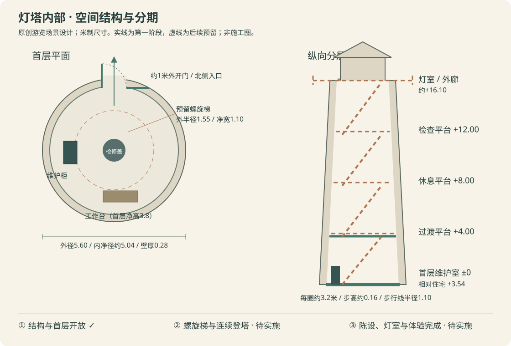

# 灯塔内部结构与分阶段实施

| 项目 | 内容 |
| --- | --- |
| 状态 | 第一～三阶段已完成；第二阶段按窗位分层与垂直梯交付，原旋梯已替代 |
| 创建 / 更新日期 | 2026-10-18 / 2026-10-19 |
| 实现提交 | `b6116c0`：首层结构与验收；第二阶段实现见[修订方案](2026-10-19-lighthouse-vertical-ladder.md)，第三阶段见[收尾方案](2026-10-19-lighthouse-interior-finish.md) |
| 代码基线 | `a4c1f14`，沿用灯塔A～D外观及40 km/h小电驴 |
| 相关方案 | [灯塔与步道](2026-10-18-lighthouse-coastal-path.md)、[室外通行](2026-10-18-coastal-electric-scooter.md)、[资源原则](../resource-optimization-principles.md) |

## 1. 背景与现状

现有灯塔总高20米、基部外径5.6米，位置为`(-125,90)m`，塔前地坪相对住宅为+3米。塔身已有真实外窗洞，但只有单面外壳；入口是静态封板，塔基半径3.5米整体禁止进入。现有步行支撑按平面坐标取单一最高面，直接加入螺旋楼梯会产生串层、错误落点和恢复位置问题。

本次按用户要求先确定内部结构和后续顺序，再交付第一阶段。它是原创游览场景设计，尺寸为游戏空间参数，不作为真实建筑施工或消防规范依据。保持外轮廓、现有家居、海岸步道、小电驴、晴朗午后和资源预算。

## 2. 内部空间与动线

- **墙体**：保留收分外壳，补充0.28米厚的内衬和门窗洞口侧面；内净半径随塔身从约2.52米收至1.72米。底层圆形地面顶为相对住宅+3.54米，沿用已有石基与外台阶。
- **首层：入口/维护室**。原北侧入口净宽约1米，外开90°，门内中央留出转身空间；西侧低维护柜、南侧窄工作台，均不侵占门洞。入口至塔内连续步行，外侧两级台阶及门槛单级高差≤0.18米；塔基其他方向不可攀入。
- **竖向预留（初案，已替代）**：中心螺旋梯内半径0.45米、外半径1.55米，净宽1.10米；步行线半径1.10米、每步约18°，每圈提升约3.2米。上部最窄处保留约0.17米墙侧安装余量。首层中央标记圆形检修盖，第一阶段以封闭盖板表达预留位置，不制作可攀爬的假楼梯。
- **中间休息/检查平台（初案，已替代）**：相对首层约+4、+8、+12米，每段约25步、步高约0.16米；平台沿梯出口局部加宽，避免整层圆盘挡住楼梯。最终步数、平台开口及扶手连接在第二阶段以真实碰撞/净高验收收口。
- **上层灯室和外廊**：相对首层约+16.10米接到现有外廊，保持灯具底座和八角玻璃灯室；登塔终点与灯具检修区分隔。灯室出口、外廊净宽及镜头构图在第二阶段复核，第三阶段完成细节。
- **第一阶段上界**：首层净高3.8米，设置真实封闭顶板，后续由楼梯洞口替换；上层暂不开放，地图和室内提示说明阶段范围。顶板上方保留中空塔身及真实透光窗。

## 3. 分阶段交付

| 阶段 | 交付范围 | 验收门槛 |
| --- | --- | --- |
| 一：结构基础与首层开放（已完成） | 同源米制布局、内衬/洞口侧面、首层地坪/顶板、双面可交互外开门、台阶/门槛支撑、维护柜/工作台/检修盖、碰撞与区域提示 | 真实输入进出和闭门阻挡；关门扫掠保护；塔壁/窗/侧向塔基/柜台防穿越；跳跃/暂停/位置恢复；生产独立托管和预算 |
| 二：按窗位分层与垂直梯（已完成） | [修订方案](2026-10-19-lighthouse-vertical-ladder.md)：五个楼面、贯通垂直梯、逐层停靠/离梯、灯室常开出口与受保护外廊，多高度支撑/净空及恢复 | 真实按键逐层上下及每层离梯看窗；不串层/穿墙/落井；地图/预设/设置/ESC原位恢复；独立发布与资源预算。塔外一次初始夹具之后全程真实输入，未重跑住宅至塔全路段 |
| 三：室内完成与整体收尾（已完成） | 维护工具/记录、设备/配电、原灯具细化、受控室内照明、细节材质/声音及地图楼层表达 | 近景/远景一致；楼层指引明确；功能回归、可用浏览器矩阵、来源与完整发布记录 |

## 4. 第一阶段技术方案与取舍

1. 在独立布局模块维护首层、通道、台阶和柜台占位。首层物件的几何与阻挡共用尺寸；楼梯参数只作为后续接口，不能宣称已可登塔。
2. 保留现有外壳绕序与远景轮廓，派生内向墙面，并对真实边界补洞口侧面；窗后静态黑板移除，保留玻璃和窗棂。首层顶板隔开尚未开放的上层。
3. 通行从整圆阻挡改为“外部塔基禁入 + 北侧窄入口 + 内部可走圆 + 柜台阻挡”。室内地坪、门外两级台阶及门槛使用渲染同源支撑。台阶只在入口通道可上，不能从圆形塔基侧面直接踏入。
4. 外开门复用现有`RoomInteractions`的动画、角度扫掠、双面拾取和音效。显式允许灯塔自身遮挡交互射线，避免隔墙开门；移动门网格不冻结、不进入静态阴影投射列表。首期用既有SSAO表达门与地面接触，不因门动画刷新整张室外阴影；移动门的直接投影保留为后续视觉取舍。
5. 灯塔实体随海岸所有者释放，避免纳入每个房间重建；复用既有海岸PBR/日光/环境及失败降级，不增加下载素材、灯、相机、RTT或依赖。首层保持环境反射照明，第三阶段再评估独立灯光。
6. 小电驴保留塔基完整禁入规则；人物开放入口不能意外让车辆驶入。地图首层区域和第一人称提示明确“上层暂未开放”。

## 5. 实施顺序

1. 建立本方案、索引和变更日志，记录基线与阶段边界。
2. 实现布局、墙厚、首层几何、外开门及区域提示。
3. 接入支撑、塔基/柜台边界、交互遮挡、生命周期和车辆禁入。
4. 单测保护真实几何/支撑一致性、门扫掠和禁止穿越路径；运行类型检查、完整测试、临时开发构建、正式生产构建与自动发布校验。
5. 仅托管`dist`，保存真实键盘进出、闭门/扫掠、近景/横竖屏、地图/预设恢复与原房屋交互回归；检查根/子路径文件摘要、实际首屏JS、Inspector及下载素材不变。
6. 补充实际验收、字节、截图和限制，更新方案/索引/CHANGELOG后提交推送当前分支。

## 6. 资源和验收边界

原预算：两目标GLB≤4.25MiB、运行素材≤16MiB、首屏JS（含必需异步）≤3MiB、完整发布≤41MiB，不调整。新增程序几何目标≤8,000顶点、≤12网格、无新增纹理下载；不以原室外160,000顶点设计目标掩盖新增室内结构成本，分别报告旧外景/新增塔内/总量。

第一阶段不包含登塔、旋转光束、昼夜/天气、NPC、任务、背包或存档。延续此前暂停的FPS/加载耗时实验，截图和字节只证明对应画面/资源结果。Safari/Firefox/物理设备若无法使用，应保留为未验。

## 7. 第一阶段实际结果（历史）

第一阶段已完成：新增厚壁内衬/同源洞口侧面、首层地坪与真实顶板、维护柜/工作台/检修盖和可双面交互的外开门；实际北侧台阶/门槛与渲染高度一致，可正常进出。塔基侧向、墙窗、柜台及车辆禁入保留；地图/帮助注明首层和后续开放范围。没有实现登塔楼梯，也没有把检修盖标为可交互。

[153项测试、工程/浏览器和发布记录](assets/lighthouse-interior-1-2026-10-18/README.md)通过：Chrome真实键盘进出、双侧闭门阻挡、门扫掠暂停/恢复、跳跃与地图/预设恢复；Chrome/WebKit十二个横竖屏/DPR组合，原房屋8抽屉/8灯/各门/55段路线、地图/信件/设置/Inspector/双卫镜面与重复释放。153项测试、类型检查、临时开发及生产构建/自动发布校验通过。截图在正常渲染循环下重采并视觉检查，避免把视口变化后的空白帧当成画面验收。

36素材及两件GLB不变，无新增下载、材质、纹理、灯、相机、RTT或依赖。首屏JS为2,856,386字节（12个JS，含必需异步），静态初始2,637,534字节，完整发布42,260,009字节（495文件），较调参后基线分别+5,523/+5,523/+5,811字节。新增12网格/2,531顶点替换旧结构后净增10网格/1,997顶点；外景与载具合计159,647顶点。根路径/子路径495文件摘要、实际首屏与按需Inspector通过，原预算不变。

实际取舍：移动门不参与静态缓存阴影，保留SSAO；首层使用既有海岸环境照明，精细灯具和陈设在第三阶段收口。WebKit为固定镜头验证，完整键盘进出仅计Chrome；Firefox/Safari/物理设备与暂停的FPS/加载实验未验。第二阶段仍需实现多高度支撑、净空、平台开口和外廊连续路线；第三阶段仍需完成设备/照明/声音和整体收尾。

## 8. 第二阶段旋梯设计（2026-10-19，已替代、未交付）

用户反馈旋梯狭窄、卡住和绕圈眩晕，明确改成按窗位分层的垂直梯；以下保留为已替代设计，当前实施以[窗位分层与垂直梯方案](2026-10-19-lighthouse-vertical-ladder.md)为准。原101步代码与测试在本次替代中移除，未作为已交付功能保留。

实施基线`9019ca1`，按用户“完成第二阶段”授权执行；第一阶段验收保留为历史。范围为完整螺旋梯、三个中间平台、灯室常开检修出口与可绕行的受保护外廊，以及多高度支撑/扫掠/净空/位置恢复。细设备、声音与独立照明仍留第三阶段。

### 8.1 几何与动线

1. 移除首层封闭顶板和中心预留检修盖，增加中心柱、实体木踏步/深灰金属扶手。内半径0.45米、外半径1.55米、步行线1.10米、每步18°；前三段各25步×0.16米，最后26步合计4.10米，共101步。+4/+8/+12米各设置36°水平扇形休息平台，平台外半径局部加至1.65米。
2. 按转角/半径/高度生成不可变扇形数据，真实踏步为有厚度的梯形扇段，支撑查询使用同一弦边界。台阶与平台按材质合批，扶手上下连接、端头及内外侧保护连贯；中心柱、栏杆与地面阻挡独立于起跳高度，不能跳越。
3. 每整圈常规提升约3.2米，经过休息平台局部降至约2.88米，扣去踏板厚度后仍须通过实际最小头顶净空断言。底层低梯段下方不允许人物穿入不足净空处；柜台阻挡只作用于其真实高度，楼梯从其上方经过时不产生无限高障碍。
4. 现有塔顶檐口改为有中心通孔的环形结构；+16.10米外廊地面切出覆盖末13步的开口（234°、半径约1.58米），供身体穿出，避免只留脚能穿过的小洞。原初值12步/216°在恢复顶层平台0.30米结构厚度后净空不足，因此增加到13步/234°。楼梯末段从36°方向接顶层实地面。
5. 移除八角灯室东南侧（法向67.5°）一片玻璃，保留边柱作为常开出口；可从楼梯出口经灯室沿此口到外廊。灯具本体、其余七面玻璃、中心楼梯洞及外廊边缘均保护，外廊栏杆补到1.10米高。灯室/外廊精细表现仍由第三阶段完成。

### 8.2 通行与生命周期

- `walkingSurfaceAt`接受脚底高度，在当前高度可达范围选择最高支撑，查找上方真实踏板/顶盖作为净空；无高度参数的原调用继续查询首层/室外地面，不把塔顶地面投影到塔底。
- 水平扫掠在塔内细分至约5厘米，沿途逐阶传递支撑高度；地面步行每次只允许≤0.18米的上下阶差，最终高度一并交给垂直控制器，长帧累计跨多步不回退到低楼层。空中移动不预先抬高脚底，保留重力与真实落点。
- 使用同层护栏半径/洞口、收分墙体和灯室玻璃线段保护整个身体；首层侧向塔基和车辆整塔禁入保持。脚底高度参与地图区域、稳定落点、预设/地图恢复，门扇安全检查增加垂直区间，防止塔底门误挡上方外廊姿态。
- 沿用海岸所有者、材质/环境/日光、缓存阴影及重复释放；无新增依赖、下载、材质、纹理、灯、相机或RTT。

### 8.3 资源取舍与验收

第一阶段室外/塔内/载具合计159,647顶点，原160,000是外景设计目标，已无足够余量容纳完整楼梯。第二阶段将新增结构单独分配≤12,000顶点、≤6个合批网格；保留旧外景/塔内/载具分类实测，不将新增室内几何隐藏进原外景数字。[资源原则](../resource-optimization-principles.md)中的四项硬字节预算及发布白名单不调整；相应测试继续保护原外景数量，并独立检查新楼梯上限。

验收包括：逐步/跨帧上下全部101步和三个平台；同XY多楼层及头顶射线对照真实网格；内外扶手/墙窗/灯具/玻璃/外廊跳跃与长帧边界；每平台、灯室和外廊地图/预设原位恢复；从住宅经步道到塔顶再返回的连续输入路线（不以塔内定位夹具代替全程）。完成153项原测试及新增必要用例、类型/开发/生产构建、独立根/子路径完整摘要/实际首屏/Inspector、Chrome实际输入和Chrome/WebKit横竖屏/DPR画面与生命周期回归。正常截图在渲染循环和视口稳定后采集并检查非空白；性能实验继续暂停，受限平台如实标为未验。

该旋梯方案未交付，不再追加实现结果；以修订后的垂直梯方案和验收为准。

## 9. 第二阶段修订交付（2026-10-19）

已在`63e6272`按[窗位分层与垂直梯方案](2026-10-19-lighthouse-vertical-ladder.md)完成首层、二/三/四层和顶层五站；楼板与三窗台保持0.90米关系，E抓梯/离梯、W/S上下，每层自动停稳，保持镜头朝向。原封闭顶板/检修盖和未交付旋梯移除，灯室常开口接通可绕行外廊。

161项测试、类型/开发/生产构建、Chrome实走五层往返和暂停恢复、Chrome/WebKit十二组合、住宅交互/双镜面/独立发布通过，详见[验收记录](assets/lighthouse-ladder-2026-10-19/README.md)。新增结构6合批/3,264顶点，净增4网格/2,202顶点；36素材及硬预算保持。第三阶段设备细化、照明/声音与陈设仍待实施。

## 10. 第三阶段交付（2026-10-19）

依据用户“完成灯塔方案的剩余阶段”，按[第三阶段细化方案](2026-10-19-lighthouse-interior-finish.md)推进设备/记录、可控局部照明、原灯具细节与楼层地图，维持垂直梯及原字节预算。已完成维护设备/工具/可查看记录、五层工作灯/开关及既有声音、顶层透镜/保护框与层号牌，地图显示五层剖面/当前位置。166项测试、类型/开发/生产构建、Chrome住宅→灯塔五层/外廊→住宅连续真实输入、Chrome/WebKit十二组合/36图、原住宅/双镜面及根/子路径495文件摘要通过。新增9合批/2,718顶点、3材质/1生成图集/1局部灯，无新增下载、相机或RTT；实际首屏JS2,878,607字节，完整发布42,283,079字节，预算不变。详见[第三阶段验收](assets/lighthouse-finish-2026-10-19/README.md)。三阶段工程及可用浏览器交付完成；Safari/Firefox/物理设备与暂停的性能实验仍未验，独立昼夜方案不属于本轮。
