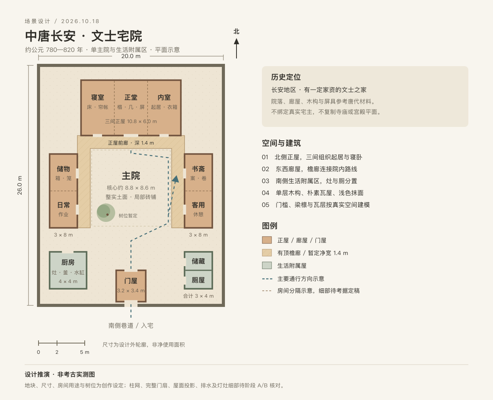

# 中唐长安文士宅院场景方案

- 状态：方案已完成，场景开发待实施；建筑细部考据与素材定稿待阶段 A。
- 创建日期：2026-10-18
- 更新时间：2026-10-18
- 调研时的代码基线：`2581be579f8042c0b7d74b214011f38d4b6c10e8`。
- 本轮交付：历史依据、建筑与陈设设计、素材取得路线、平面示意及开发验收计划；未修改运行场景，未下载或接入第三方运行素材。
- 相关规范：[项目协作约定](../../AGENTS.md)、[资源与首屏优化原则](../resource-optimization-principles.md)。
- 相关方案：[场景复用准备](2026-10-17-scene-reuse-foundation.md)、[资源大小优化](2026-10-14-study-resource-size-optimization.md)、[Tree-Shaking](2026-10-15-study-tree-shaking.md)。

## 1. 背景与定位

用户希望建筑结构、装修与物品都符合唐代历史特点。现有项目是现代海岸住宅，具备第一人称、门扇交互、物品查看和地图基础，但既有户型、家具、玻璃窗与生活设施不能直接改色后作为唐宅；公共模块也尚未完成通用化。

建议制作 **公元 780—820 年前后、长安地区一户有一定家资的文士之家**。住户不绑定真实人物或官阶；季节暂定初秋，主展示为白昼，辅以局部夜间油灯视角。这个设定允许读书、接客、饮茶和家庭生活同时出现，又能控制宫廷等级的装饰与器物数量。年代、身份、季节均为本方案的创作设定，不是考古结论。

交付定位为“有史料依据的假想住宅复原”。现有证据不能确定本宅每根柱、每处隔墙与全部家具的真实样式，不标榜某座唐宅的原样重建。院落与房间尺寸是面向建模和第一人称体验的设计值，不能写成唐代统一规制。城坊中的具体地块、唐尺换算及官员营缮等级不在证据不足时强行指定。

## 2. 历史证据与采用边界

以下链接于 2026-10-18 查阅。A 表示有馆藏实物、图像或调查资料直接支持某个特征；B 表示将同时代、异地或不同使用情境的材料用于有限类比；C 表示本场景的合理推演。A 也不意味着该物必然存在于本宅，三类均须分别记录年代、地域和使用者。

| 编号 | 来源与已核实内容 | 能支持的设计 | 不能据此声称的内容 |
| --- | --- | --- | --- |
| H01 | 欧阳恬之，清华大学 2005 年论文[《隋唐两京里坊“割宅”制度及宅基地分配方法研究》](https://newetds.lib.tsinghua.edu.cn/qh/paper/summary?dbCode=ETDQH&sysId=175048)，本轮阅读公开摘要 | B：里坊内住宅、院落与地块组织的研究入口 | 尚未阅读全文；不能由摘要推出本宅的 20×26 米地块、三间正屋或具体柱网 |
| H02 | 敦煌研究院[莫高窟第 172 窟](https://www.dha.ac.cn/info/1425/3688.htm)，盛唐，院落建筑画与斗栱说明 | A：唐代建筑图像；B：廊院组织、木构承托和舒展檐部的参考 | 净土经变中的宫殿、寺院是宗教性图像，不能整套当作普通住宅；本宅不复制高台殿堂和楼阁 |
| H03 | 敦煌研究院[莫高窟第 79 窟](https://www.dha.ac.cn/info/1425/3618.htm)，盛唐，六扇屏风及居室摆设意匠 | A：联屏图像；B：屏具参与空间组织 | 佛龛中的屏风画不是本宅家具的尺寸图，也不能由此规定家家六扇屏风 |
| H04 | 故宫博物院胡德生[《古代的椅和凳》](https://img.dpm.org.cn/Uploads/pdf/1546/T00023_00.pdf) | A：椅凳发展材料；B：唐代低、高坐具并存的判断 | 不把唐人概括为全部席地，也不用成熟明清圈椅、官帽椅反推唐椅 |
| H05 | 故宫博物院[邢窑白釉玉璧形底碗](https://www.dpm.org.cn/collection/ceramic/227109.html)，唐，高 4.7、口径 15.6、足径 6.7 厘米 | A：素白瓷碗形制与真实尺度，可作为近景建模原型 | 页面断代为整个唐代；特定亚型是否适合约 800 年仍须复核，不将本宅摆放视为出土事实 |
| H06 | 中国国家博物馆[“古代中国”隋唐五代展](https://www.chnmuseum.cn/portals/0/web/zt/gudai/detail6.html)，白瓷砚：唐，高 7.2、径 14.8 厘米，1957 年河南陕县唐墓出土 | A：陶瓷砚的尺度、材料和造型参考 | 墓葬出土不证明每件都是日常实用品，必须核对器物功能和完整图版；不把明器缩尺当作使用尺寸 |
| H07 | Met [Mirror with fantastic animals](https://www.metmuseum.org/art/collection/search/61387)，藏品号 17.118.93，7—8 世纪，青铜，径 11.7 厘米，图片标记 Public Domain | A：唐镜背纹与尺度；B：较早器物沿用到目标年代的设定 | 不是玻璃镜，也没有据此核实镜架样式；本宅持有关系属于推演 |
| H08 | 上海博物馆[《唐 楷书大般涅槃经第九卷》](https://www.shanghaimuseum.net/mu/frontend/pg/article/id/CI00004698)，纸本、卷、盛唐写经 | A：纸本卷轴、竖行书写的参考 | 经卷不能直接证明私人家书的内容、行款及所有书籍的装帧；不照搬清代收藏印与后配装裱 |
| H09 | 中国国家博物馆[《茶瓶》](https://www.chnmuseum.cn/zp/zpml/201812/t20181218_26046.shtml)对《茶经》中煎茶法与后期点茶的区分 | A：煮水、投末、搅动、酌入碗的程序依据 | 页面展示的成套模型不能当成约 800 年的实用全套茶具；不复制模型尺寸或混入晚期点茶程序 |
| H10 | 中国国家博物馆[《鎏金银茶托》](https://www.chnmuseum.cn/zp/zpml/kgfjp/202111/t20211116_252276.shtml)，含 860 年铭文、左策使茶库背景 | A：明确的晚唐高等级器物；本方案用作年代与身份的排除对照 | 不用于约 800 年普通文士的成套茶席，不能因“唐代”标签就提前六十年使用 |
| H11 | 故宫博物院[《双双瓦雀行书案》讲座记录](https://www.dpm.org.cn/classify_detail/259400.html)，介绍髹漆家具与硬木家具发展的区别 | B：家具选型的历史检查 | 内容跨越多个朝代；其中明清的床榻、桌椅分类与造型不能整体移植 |

建筑实物的进一步核对对象为南禅寺大殿及其调查、修缮资料：祁英涛、柴泽俊《南禅寺大殿修复》（《文物》1980 年第 11 期）、柴泽俊《南禅寺大殿修缮工程技术报告》（《文物保护技术》1981 年第 1 期）。**本轮未取得和通读这些报告，列为阶段 A 待调阅资料，不用其未读图纸给出唐宅斗栱尺寸。**即使读到，也只用于同年代木构逻辑的类比，须区分后世维修构件与原构，不照搬佛殿平面、台基、门窗复原或宗教陈设。清代《工程做法》与宋代《营造法式》不能直接充当本宅的唐代施工定式。

## 3. 整体建筑与平面

### 3.1 空间组织

采用“一座主院＋南侧生活附属区”。北侧三间正屋，东西两侧为低矮廊屋，南侧设一间门屋；厨房与储藏、厕屋位于南侧两角。正屋与两侧通行通过檐廊衔接。整体借鉴院落住宅的组织方式，不照搬成熟北京四合院的固定房间名称、门制或轴线礼序。

[查看大图 SVG](assets/tang-residence-2026-10-18/floor-plan.svg)。图为可编辑的方案示意，不是发掘实测图；图中开口表示通行位置，未绘制全部门扇、柱网与檐口投影。

| 区域 | 暂定外轮廓尺寸 | 布置与体验 | 证据等级 |
| --- | --- | --- | --- |
| 宅地 | 东西 20 米、南北 26 米，约 520 平方米 | 单层、坐北朝南；围墙与南侧里坊巷道形成边界 | C：本场景选择，不是标准唐宅面积 |
| 北侧正屋 | 面阔 10.8 米、进深 6 米，三间各 3.6 米 | 中间接客和家人起居，西间寝卧，东间内室；屏具、帘与轻隔断组织空间 | 院落、木构与屏具参考 H01—H03；间数、尺寸及用途分配为 C |
| 正屋前廊 | 深 1.4 米 | 形成室外到室内的明暗过渡，可见柱础、门槛、檐下木构 | C：宽度与衔接需灰盒验证 |
| 东西廊屋 | 各 3×8 米，分成两段 | 东侧书斋与客用，西侧储物与日常作业；名称是功能标签，不代表固定唐代制度 | C：可因空间或证据调整 |
| 侧廊 | 宽 1.4 米 | 连接正屋与侧屋，避免雨天所有路线都穿过裸露院心 | 组织为 B，具体宽度与接合为 C |
| 主院核心 | 约 8.8×8.6 米 | 院心保留大片整实土面，门前及廊边局部铺砖；一株小型落叶树与少量盆钵 | C：树位、种类、铺装比例均非出土结论 |
| 门屋 | 3.2×3.4 米 | 朴素木板门，门轴与门闩可见；向内开合须避开玩家路线 | C：不使用未核对等级的乌头门、阙门 |
| 西南厨房 | 4×4 米 | 灶、釜、陶罐、水缸与柴薪；设朝院侧开口，烟尘影响局部表面 | C：具体灶型、排烟结构待补证 |
| 东南附属屋 | 3×4 米，前后分隔 | 储藏与厕屋分开进入，厕屋靠外墙维护；不与厨房形成室内直通 | C：暂不展示便器、粪坑剖面与具体清运设备 |

上述房屋外轮廓投影合计约 152 平方米（含门屋、不含檐廊，不是净使用面积）。每段屋顶的挑出、墙厚、门槛与可通行净宽在灰盒阶段统一扣算，不直接把表格外轮廓当作房间净空。饮用水先表现为厨房水缸，不为了视觉完整而宣称每户都有院内井。

### 3.2 承重与屋顶

1. **台基与木构**：正屋建立可读的石础—木柱—梁枋—檩—椽—瓦层关系；墙面作为围护表达。外露的柱梁必须相接，不能让屋顶仅靠抹灰墙盒子悬空。正屋台基暂定高约 0.35 米，两级踏步只是灰盒值，不是唐代法定数值。
2. **屋面**：首选单檐、两坡、檐部适度挑出的朴素瓦屋。暂按悬山式轮廓出灰盒，具体山面与收边保留 B/C 标记，阶段 A 核对后才定稿。采用板瓦与筒瓦组合的灰色陶瓦表达，不用现代 S 形机制瓦代替。屋面曲线舒缓、屋角抬升克制；不指定所有唐屋必须统一坡度。
3. **檐部与斗栱**：不把“唐风”等同于全屋装满巨大斗栱。优先用清楚的柱梁和出檐关系建立体量；主屋是否使用简化柱头承托、斗栱层数和构件尺度，须有匹配住宅身份的证据后确定。H02 的宫殿寺院斗栱只作结构类比。
4. **屋脊**：首版采用素脊与简单封头，不摆明清式成串走兽，也不先放巨大鸱尾。若后续增加脊饰，先补年代、建筑用途与身份匹配证据。
5. **围墙与排水**：土质墙体、局部抹面及瓦压顶为候选；墙脚、檐下设置有去向的散水与排水沟。屋面水流和院地高差要连贯，具体材料、沟型及出水口为 C，不能伪称本宅考古复原。

### 3.3 门窗与室内装修

- 以木板门、直棂式木窗、帘与屏具形成开合层次；直棂窗的分格、位置与尺寸仍需阶段 A 查图核对。首版不增加成片透明玻璃、日式障子门或现代窗扇五金。
- 墙面表达土质基层与浅色抹面，局部有修补、烟熏和磨损；材料配方与抹面分层未确证时只描述外观，不将现代乳胶漆或水泥贴图宣称为唐代原材。
- 主色为灰瓦、暖灰白墙、木褐色与少量暗朱/黑漆；这些是本宅的克制配色，不表示唐代整体色彩寡淡。重点色放在一件屏风和织物边饰，暂不做整屋金碧彩绘。
- 露出主要梁架，室内顶棚另需证据后才加。不得把石窟覆斗顶、佛殿藻井直接变成住宅天花。
- 地面以整实土、局部砖铺与可移动席垫区分空间。席的边缘、编织方向和厚度可读，不铺满整室日式榻榻米；也不沿用现代木地板的企口和涂装外观。

## 4. 家具、器物与生活方式

总体采用“榻、席、几案为主，少量高坐具按证据加入”的室内方案。唐代处于高低家具并存的阶段，不能把所有起居都做成跪坐，也不能整屋摆明式桌椅。屏具和帘承担部分空间分隔；陈设留出使用空间，避免博物馆展柜式堆满名品。

| 场所 | 首版物品 | 设计要求与来源 | 定稿前限制 |
| --- | --- | --- | --- |
| 正堂 | 低榻 1、几案 2、移动席垫、屏具 1 | 榻边坐卧，几案高度暂定 0.28—0.38 米；漆木或普通木材外观；屏具参考 H03 | 家具尺寸为 C；榻足、屏座、连接方式须用具体唐代图像核对，不能套用明清罗汉床 |
| 书斋 | 书案、卷轴、笔、墨、陶瓷砚、水盂、书箱 | 笔墨使用痕迹集中在案面；书卷参考 H08，砚参考 H06 | 不放满墙现代书架、线装书海、玻璃镇纸或后世款识；家书另写原创内容并校验时代词汇 |
| 寝室 | 木床、席褥、枕、帘帐、衣箱 | 外形以朴素木构和织物为主，褥面用麻、丝或其他已核实纤维 | 不使用成熟明清拔步床、婚床雕饰、成套紫檀家具；织物材质与具体床架细部需补图证 |
| 内室 | 衣箱、盆、巾、铜镜与镜匣 | 铜镜按 H07 径 11.7 厘米比例建模；镜背与镜面分别处理 | 首版不做未经核实的立式镜架；不把埋藏千年的满面绿锈当作唐人正在使用的表面 |
| 饮茶处 | 风炉、鍑、茶末容器、竹制搅具、茶碗 | 采用 H09 的煎茶动作，首版只演示必要步骤；白瓷碗按 H05 建模 | 不出现盖碗、公道杯、紫砂壶和现代整套功夫茶盘；不用 H10 的 860 年银茶托套装 |
| 厨房 | 灶、釜、陶罐、水缸、木桶、柴薪 | 器物按烹煮与储藏用途放置，火源离木架和布帘有空间 | 灶型、釜耳及排烟做法未核实时保持简化 C，不用现代炒锅灶台与抽油烟设备 |
| 廊院 | 清扫用具、盆钵、有限生活杂物 | 通路清楚，避开廊柱与门槛，院地有局部落叶和脚步磨损 | 不默认配置成熟江南园林的太湖石、曲桥鱼池、月洞门；不放鸟居、枯山水和日式石灯笼 |
| 夜间局部 | 小型陶瓷或陶质油灯 | 先补匹配年代的实物原型，再确定灯盘与灯芯位置；只照亮近处 | 灯型仍待补证；烛灯不是唐代不存在，而是本宅首版选择油灯，不做满院节庆灯笼 |

三彩器按用途逐件判断，不将其一概称为不能日用；本宅不拿三彩马俑、镇墓兽、武士俑作为日常家居装饰。陶瓷以素白、青釉、无釉陶的日常组合为优先，初版不陈设成熟元明青花和清代粉彩。金银、玻璃与异域奢侈品在唐代有实例，但不据此让这一户普通文士拥有整套宫廷珍品。

不直接借用《韩熙载夜宴图》、宋画、明清家具图录或当代仿唐影视布景作为约 800 年的直接证据；跨时代材料必须独立标 B 并说明可比之处。每个可交互重点器物都应有自己的原型编号与尺度，无法核实的装饰宁可简化。

## 5. 素材从哪里来、如何制作

### 5.1 采购与制作路线

建议采用 **主体建筑原创模块化建模＋重点器物按馆藏重建＋少量 CC0 通用表面素材**。截至本轮，没有核实可直接下载、形制与断代均适合此宅的整套唐代住宅 GLB；因此不承诺购买一个“唐风资产包”就能满足要求。

| 素材类别 | 取得地点 / 具体入口 | 实施方式 | 历史与许可边界 |
| --- | --- | --- | --- |
| 柱、梁、檩椽、门、窗、瓦、台基 | H01—H03、待调阅南禅寺资料 | 原创参数化建筑模块；复杂接合可在 Blender 制作，再输出受控 GLB | 不下载宫殿/寺庙整模充当住宅；建模前为可见细节补证 |
| 榻、几案、屏具、箱、床 | H03、H04 的具体图像；补充唐墓图版后固定原型 | 自建约 6—8 种可复用家具原型，改变摆放而非拼凑朝代 | 研究图片仅作参考，不自动获得贴图或扫描模型的再发布许可 |
| 碗、砚、镜、卷 | H05—H08 的馆藏页面、尺寸与正侧面资料 | 回转体建碗与陶罐；雕纹、器足依原型重建；卷轴和纸面自制 | 研究尺寸与取得图片使用权分别记录；H05/H06 仍需核对目标时段和明器属性 |
| 木材微表面 | Poly Haven [Rough Wood](https://polyhaven.com/a/rough_wood)，Rob Tuytel；本项目已有 [Wood Table 001](https://polyhaven.com/a/wood_table_001)，Dimitrios Savva / Rico Cilliers | 前者仅作未髹饰木材的颗粒候选，去掉过度朽裂；后者只取适量木纹并重新设计漆层 | 两者是现代扫描表面，非唐木材样本；漆木不能让深木纹穿透整层漆 |
| 浅色抹面 | Poly Haven [White Rough Plaster](https://polyhaven.com/a/white_rough_plaster)，Rob Tuytel | 仅选择适用微表面，控制剥落；主体也可原创程序化生成 | 扫描材料配方不作为唐代证据，不整面复制废墟般破损 |
| 院地 | Poly Haven [Dry Ground Rocks](https://polyhaven.com/a/dry_ground_rocks)，Rob Tuytel | 减弱大石与深裂缝，用作整实土面的细节候选；砖铺另原创 | 本场景是有人维护的宅院；土色和尺度由参考与画面确定 |
| 织物、席与瓦面 | 原创编织/瓦面；[ambientCG](https://ambientcg.com/) 仅作备用筛选库 | 席条、边缝与瓦列模块自行建立，通用纤维只提供微表面 | 本轮未选定 ambientCG 具体资产，不能把检索入口写成已取得素材 |
| 屏画、织物纹样、文字 | H03 的联屏组织、H08 的书写形态；画面和书信原创 | 先绘普通花木或素屏方案，纹样、行款再经历史复核 | 不把宗教壁画整张贴在宅内；不混入宋体印刷字、后世诗文、清宫收藏印 |
| 铜镜背图像 | H07 对应 Met 图片，页面标记 Public Domain | 可作为重绘、雕纹的开放图像来源；项目保留藏品号与下载记录 | 本轮核实的是图片开放标记，没有取得可直接用的三维扫描模型 |
| 环境与音效 | 现有已记录的 CC0 环境/录音，或后续自录木门、脚步与纸声 | 按本宅门轴、砖土和纸张重新试听选型；日光、天空优先复用工程能力 | 不直接播放含现代交通、空调、电器的录音；海岸环境只复用技术，画面与声景另选 |

Poly Haven 的[资产许可](https://polyhaven.com/license)与 ambientCG 的[许可说明](https://docs.ambientcg.com/license/)均明确提供 CC0 资产；Poly Haven 的网站文字、标志与示例渲染不因此一并成为 CC0。馆藏网页可看、古物年代久远和扫描文件可下载，都不能自动推导为图片或模型可任意再分发。未查到开放标记或明确授权的馆图保持“研究参考”，实际贴图优先原创，授权未确认的扫描资产不进入运行白名单。

正仓院的[赤漆欟木胡床](https://shosoin.kunaicho.go.jp/treasures/?id=0000014625&index=1108)可作为奈良时代器物的后续比较入口，但本轮只核实检索条目，动态详情未完整载入；不据此确定家具尺寸，不把日本制作、异地保存的器物一概称为中国唐代进口原件，也不照搬整套日式室内。

### 5.2 资产记录与接入

实施时为每项素材建立记录：`id / category / creator / sourceUrl / accession / dateRange / region / evidenceGrade / intendedUse / dimensions / imageOrModelLicense / licenseEvidence / originalSHA256 / processing / outputPath / outputSHA256 / reviewStatus`。其中历史依据与素材许可各自判断，不用 CC0 证明断代，也不用博物馆名称替代授权证据。

- 约 780—820 年之外的原型单列日期；若作为旧物沿用，写明推演理由。仅断为“唐”的原型在定稿时进一步查亚型，不把 618—907 年的三百年当成一种固定风格。
- 原件、`.blend`、高分辨率参考和压缩实验放在运行白名单之外；运行用资源统一单位、轴向、UV、材质通道与摘要。文档图片不自动加入生产发布目录。
- 当前古董柜、书架、装饰画的未核实许可状态不能变成新场景授权；它们的造型也不适合直接用作唐代陈设。现代沙发、扶手椅、台灯、洁具和玻璃镜均不迁移。
- GLB 接入前检查纹理、扩展、外部 URI 与解码需求；新格式先受控试验，不因为减小字节而预先宣称加载或 FPS 提升。

## 6. Babylon 实施路线与资源约束

### 6.1 场景边界与复用

本轮不创建新仓库或修改现有入口。后续开发建议先在隔离的场景目录与独立入口中实现，并使用独立输出目录及发布 URL；具体组织方式在阶段 A 固定。共用底层运行、输入、地图和交互能力，建筑、内容、灯光配置独立。现有 `HouseRoomId`、全屋坐标和专用材质不能直接冒充通用 SDK。

可复用方向是门扇状态、玩家扫掠保护、稳定姿态恢复、地图同源坐标、物品查看、资源释放与音量控制；新的 `TangLayout / TangArchitecture / TangFurnishings / TangEvidence` 是拟议模块名，尚无实现。建筑、地图和碰撞读取同一份布局，保留真实门窗洞口与连续地面。历史门槛不为漫游直接删掉，采用可配置踏越与经过验证的碰撞方案。

首个可用版本包含全院基础结构与连续通行，重点精做正堂、书斋和寝室。厨房、储藏、厕屋先达到位置、开口、功能和基本外观完整；灶具内部、排污、人物及完整家务模拟后续另立范围。

### 6.2 预算

当前项目约束保持：两个既定目标 GLB 合计 ≤4.25 MiB、运行素材 ≤16 MiB、静态与实际首屏 JS 分别 ≤3 MiB、完整发布目录 ≤41 MiB。独立唐宅入口采用同等上限作为初始控制线；4.25 MiB 这一指标仍专指现有两件目标 GLB，新 GLB 另建清单、逐件预算并计入全部运行素材，不能声称它们受旧“两件模型测试”自动覆盖。

以下是唐宅独立发布的**规划分配，尚无实测**，全部运行素材软目标合计 ≤12 MiB，在项目硬性上限以内保留余量：

| 分类 | 规划额度 | 控制方式 |
| --- | ---: | --- |
| 自建家具/器物 GLB，含其内嵌资源 | 3 MiB | 重复物品实例化，共享几何和材质；不重复内嵌同一纹理 |
| 外置材质、屏画和文字图集 | 6 MiB | 先做约 8—12 组共享表面，近景颜色按画质选择 1K/2K，数据图单独评估 |
| 环境图 | 1.5 MiB | 选择与采光目标相符的一份，不连带加载现代海岸专用资源 |
| 音效 | 0.5 MiB | 首版只包含必要的门、脚步、纸声 |
| 分类余量 | 1 MiB | 新增必须登记，不能与前四类重复计数 |

程序生成的柱梁瓦列仍计入 JS、顶点、内存和绘制成本；实例化不等于零成本。瓦列优先用局部真实几何和共享表面表达，避免每片瓦一个独立对象；远近细节方案须先看实际近景质量。日光和少量局部油灯建立照明，默认白昼首版；夜间只有选定近景灯具投影，不能一盏油灯就新建一套实时阴影。

保持 pure/精确 Babylon 导入、显式注册与按需 Inspector。实际首屏 JS 包含必需异步加载器及着色器；完整交付包含动态分包、来源、许可和清单。正式实施时为新入口接入等价的自动预算/发布检查，不复用只认识旧资产路径的校验结果。确需改预算时同步原则、阈值、白名单与测试，本方案没有授权跳过这些约束。

## 7. 实施步骤、取舍与阶段出口

| 阶段 | 工作 | 验收出口 | 当前状态 |
| --- | --- | --- | --- |
| 0 设计 | 限定年代地域身份、依据表、建筑/陈设/素材方案与平面图 | 可追踪来源、事实与推演有区别、预算与项目规范一致 | 已完成，仅方案交付 |
| A 考据与试样 | 调阅关键建筑报告/住宅图像；核对屋顶、门窗、床榻、灯灶；做一组木构、一榻一案一碗试样；固定独立入口与模块边界 | 重点可见构件有原型卡，试样无明显时代混搭；不能核实的细节简化并标 C | 待实施 |
| B 空间灰盒 | 20×26 米院落、柱网/墙/屋顶、门洞/廊道、出生点和地图 | 不同相机高度连续双向通行，门槛和门扇不夹人，屋面/梁柱关系成立 | 待实施 |
| C 材质与陈设 | 正堂、书斋、寝室优先；生活附属屋基本完整；批量接入已核实素材 | 全景与可接近近景通过，器物单位准确、无漂浮穿插，证据与许可记录齐全 | 待实施 |
| D 交互与交付 | 门闩开门、卷轴查看；煎茶按单独流程做有限展示；生产发布和浏览器验收 | 错误/404、资源缺失、预算、根路径及子路径等检查通过，来源许可随包交付 | 待实施 |

优先把 A、B 做可靠，再用 C 提升画面；不以先买大模型包或生成一张气氛图替代结构考据。首版不加入人物、驾驶、雨雪、全院动态昼夜、多进豪宅、皇家陈设与完整烹饪系统。此取舍服务于完成一座结构与物品都可信的住宅，不是对唐代生活可能性的否定。

## 8. 验收方法

### 历史与视觉

1. 逐项审查年代、地域、住户身份、实际用途、尺寸与出处；对屏具、床榻、斗栱、门窗、灯灶重点复核。制作“证据—采用特征—推演差异”卡，不只写“参考唐风”。
2. 检查没有明清成熟家具、元明成熟青花、粉彩、现代电器、日式整室布置等时代混搭；同时不能反过来宣称唐代不存在椅子、彩饰、玻璃或三彩日用器。
3. 对正堂全景、檐下仰视、屋顶斜视、书案近景、床侧、厨房、门屋和院内回看各保存视角；复核柱础落地、梁檩搭接、瓦层厚度、门窗开口与织物接触。
4. 所有比例示意、表面颜色与房间用途的推演保留说明；本宅不得在 UI 或宣传中改称“某真实唐宅考古原样复原”。

### 工程与发布（未来实施时执行）

- 按影响运行 `npm test`、`npm run typecheck`、开发构建和生产构建/发布校验，先保证不会以开发产物覆盖已验收目录；新入口的测试与发布命令在阶段 A 固定。
- 仅托管完整生产目录，检查首屏必需异步 JS、全部动态分包、材质/GLB/音效、说明文件、根路径与子路径，以及缺失素材与导入失败时的可通行降级。
- 浏览器检查全院路线、门扇/门槛、地图位置朝向、卷轴查看、横竖屏、近景画质与实际首屏请求；记录运行/着色器错误、404 和已有告警。未提供的物理设备或不支持的浏览器能力如实标为未验。
- 不将压缩字节、离线试压或截图当作加载速度/FPS 收益；当前暂停的性能实验不因新增本方案自动恢复。

### 本轮文档验收

本轮只检查本方案、平面图、索引与变更日志的一致性、链接和 Git 差异；运行代码、素材与预算均未修改，按项目规则无需重跑渲染、测试或构建。图面检查只验证文档示意可读，不是场景画质或建筑结构安全验收。

## 9. 实际交付与遗留事项

- 已完成：方案、来源与采用边界、平面 SVG、素材取得路线、预算规划、实施阶段及验收标准；同步方案索引与变更日志。
- 文档验证：方案、索引和变更日志的 127 处本地链接均有对应文件；SVG XML 结构有效，1280×1040 PNG 已渲染并人工查看，图面与尺寸表一致；本轮 Git 差异只包含方案、图面、索引和变更日志。
- 待实施：全部 3D 场景、资产下载/建模、A 阶段细部补证、许可记录落地、工程与浏览器验收。没有实测唐宅的素材大小、加载时间或帧率。
- 关键不确定项：住宅屋顶及檐部具体做法、直棂窗分格、床榻构造、灯灶原型、厕屋设备与排水细部；不能核实的部分保持朴素且标明推演，不以生成图片补造历史依据。
- 相关提交：通过 `git log --follow -- docs/technical-plans/2026-10-18-tang-residence-scene.md` 查看“规划中唐长安住宅场景与历史素材来源”及后续修订；场景实现完成前保持“开发待实施”。
