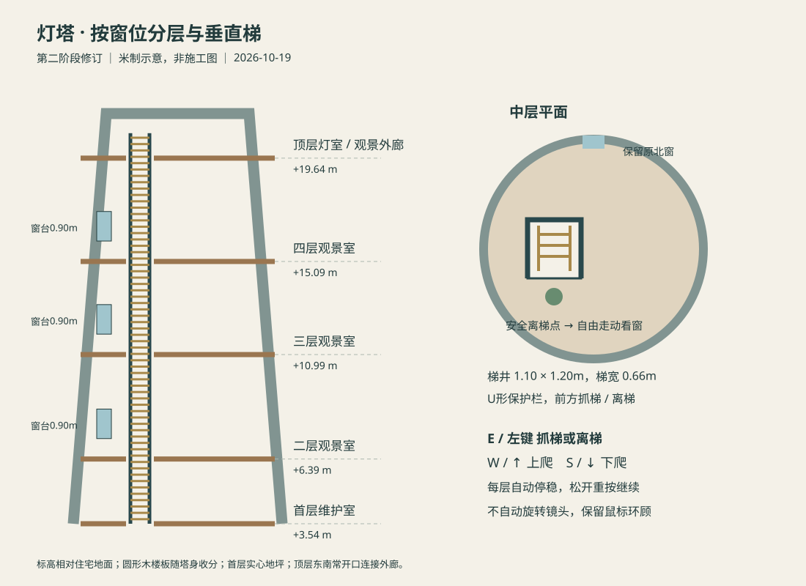

# 灯塔窗位分层与垂直梯（第二阶段修订）

> **2026-10-21 后续改造**：五层楼面与五站垂直梯布局由[入口自动关门、灯塔两层改造与步骤四](2026-10-21-lighthouse-two-levels-and-save.md)替代；现为直径6.8米、总高20米的首层/顶层双层灯塔。以下保留原阶段设计和验收历史，不代表当前层数。

| 项目 | 内容 |
| --- | --- |
| 状态 | 已完成；第二阶段按修订设计交付，原未交付旋梯已替代 |
| 创建 / 更新 | 2026-10-19 / 2026-10-19 |
| 基线 | `b6116c0`首层实现、`9019ca1`关联记录；当前`8cf7d26`仅增加独立昼夜方案，无运行变动 |
| 依据 | [原内部方案](2026-10-18-lighthouse-interior.md)、[外景/窗位](2026-10-18-lighthouse-coastal-path.md)、[资源原则](../resource-optimization-principles.md) |

## 1. 背景、目标与范围

用户反馈旋梯太窄、通行容易卡住、需要转太多圈且易头晕，明确改为垂直上下的梯子，并按已存在的三处高窗设置楼层。原第二阶段旋梯代码处于未提交、未交付状态，本轮移除该实现；保留已有首层/入口与海岸、住宅、车辆。

新体验为：进塔 → 在梯前按E/左键抓梯 → W/↑上爬、S/↓下爬 → 每层自动停稳 → 按E/左键离梯进入本层，或松开后重新按上下键继续。五个层面均可停靠及重新抓梯；攀爬全程不自动旋转镜头，保留用户朝向和鼠标环顾。第三阶段设备、独立照明/声音与细陈设仍待实施。

## 2. 按窗位确定楼层

原塔身起点相对住宅为+3.49米；三扇窗底分别为+7.29、+11.89、+15.99米，窗高均1.30米。将楼面放在对应窗底下0.90米，使1.60米眼高自然对准窗内。

| 楼层 | 相对住宅地面 | 相对首层 | 关系 |
| --- | ---: | ---: | --- |
| 首层维护室 | +3.54m | 0 | 保留原首层地坪和外门 |
| 二层观景室 | +6.39m | +2.85m | 对应最低高窗，窗台0.90m |
| 三层观景室 | +10.99m | +7.45m | 对应中间高窗，窗台0.90m |
| 四层观景室 | +15.09m | +11.55m | 对应最高高窗，窗台0.90m |
| 顶层灯室/观景外廊 | +19.64m | +16.10m | 连接原塔顶平台；东南玻璃湾改为常开出口 |

中间层为随收分墙体变化的完整圆形木楼板，厚0.16米；顶层保持0.30米结构厚度。每层使用同一个偏西矩形梯井，局部坐标`x=-1.35～-0.25m、y=-0.60～+0.60m`，净洞1.10×1.20米。梯子宽0.66米，位于`x=-0.8、y=+0.42m`，人物攀爬中心`(-0.8,+0.05)m`，每层离梯站位`(-0.8,-0.95)m`。洞口与人物半径/头部有余量，首层没有向下的坑洞；U形保护栏防止从洞边误入，前方为抓梯/离梯通道。

顶层檐口及平台切同一梯井，保留灯具中心，保护七片玻璃、洞口与1.10米高外廊栏杆。完整楼层可看窗和走动；地图/帮助显示楼层与梯上状态。

## 3. 实现和取舍

1. 把既有三窗的尺寸/高度提为共享布局数据，塔身开孔、窗框及楼层高度共用，防止窗口/楼板各自硬编码。
2. 楼板由64边圆裁切为梯井四周的凸多边形并三角化，渲染和支撑共用边界；楼板有顶/底及厚边，不新增多边形剖分依赖。首层封闭顶板和预留检修盖由真实楼层、梯井替换；撤掉所有螺旋梯代码与测试。
3. 行走支撑按脚底高度选择可达楼面，同时查找上层楼板底面作为净空；普通行走不能进入梯井、穿墙窗或跨楼层，家具只在实际垂直范围阻挡。
4. 独立米制攀爬状态使用1.6m/s参考速度（不受行走倍率影响），逐层检测并精确停靠；到层消费本次上下输入，要求松开重按后继续。松键可在梯中间停住；中途离梯给出继续到楼层的提示，不把玩家丢入井内。
5. 抓梯/离梯采用短水平平移，保持当前眼高/朝向，无自动转头、镜头绕圈或视野变化。爬梯时禁用普通水平输入和跳跃，保留鼠标环顾；原重力/步行在安全站位恢复。
6. 地图、设置、ESC、失锁/后台、预设切换均清空攀爬输入并暂停，保留梯上高度，返回后新按键才继续；主动回家才退出攀爬并回到既有家门落点。离梯检查真实楼面、边界和门扇高度，避免塔底门阻挡上层姿态。
7. 复用海岸共享材质/日光/HDR、pure/注册、缓存阴影和销毁所有权。新增程序结构目标≤8,000顶点、≤6静态合批网格，无新增下载、材质、纹理、灯、相机、RTT或依赖。旧外景160,000设计目标仍对旧部分计数，新楼层/梯子单列。

## 4. 实施与验收顺序

- 先替代技术方案并维护索引/变更日志；实现共享窗位、五层楼板/梯井、梯子和安全站位。
- 实现高度感知行走、攀爬/停靠/离梯、帮助/地图及暂停恢复；删除未交付的旋梯相关代码。
- 单测比对楼板与窗口、射线/支撑/净空、多高度同XY、梯井/窗/栏杆/灯具/玻璃边界；测试各层双向停靠、长帧、同时按键、端点、空中不可抓梯/离梯、暂停与恢复/回家，防止旧门交互和车辆回归。
- 完整测试、类型检查、临时开发构建、正式生产构建/发布校验；独立托管根/子路径所有文件摘要与实际首屏、按需Inspector。
- Chrome真实按键从首层逐层到顶、每层离梯看窗再抓梯，返回首层；三个中层/顶层地图、ESC/预设和设置暂停/恢复；可用Chrome/WebKit横竖屏/DPR图像及资源/释放，原住宅交互与镜面回归。截图须渲染/合成稳定后采集，明确夹具与实际输入边界。
- 记录实际字节/网格和未验平台；四项硬预算不变。不恢复此前暂停的FPS/加载耗时实验，也不以几何缩减推断速度或舒适度收益。

## 5. 实际结果

已交付五层楼板/贯通梯井/垂直梯、每层停靠与安全离梯、窗口观景、灯室常开出口和完整受保护外廊。首层封闭顶板/检修盖及未交付的旋梯实现均已移除；E/左键抓梯和离梯、W/↑与S/↓上下，到层消费输入；保持相机朝向和鼠标环顾。地图显示楼层/梯上状态，原住宅与车辆功能保持。

[验收记录与可复跑脚本](assets/lighthouse-ladder-2026-10-19/README.md)：161项测试、类型检查、临时开发构建、生产构建/自动发布校验通过；Chrome真实输入逐层上行/下行、每层离梯、三窗观景、外廊整圈、地图/预设/设置/ESC暂停恢复、梯上禁横移/跳跃、0.25/3倍率下独立爬速和梯上主动回家通过。Chrome155 / WebKit27.2 × 三种视口 × DPR1/2共十二组合、36张几何/材质画面与重复释放通过；住宅8抽屉/8灯/各门/55段路线、地图/信件/设置/Inspector和双卫镜面回归通过。

资源：新增结构6个合批/3,264顶点，替换旧封板等后场景净增4网格/2,202顶点；当前661网格/567,757顶点、92材质/147纹理/16灯/3相机，RTT、36下载素材、依赖与白名单不变。静态初始JS2,650,144字节、实际首屏JS2,868,996字节（12JS，含必需异步）、完整发布42,273,039字节（495文件），较首层分别+12,610/+12,610/+13,030字节；两GLB4,332,840字节、运行素材15,867,631字节不变。根路径与`/home/`全部495文件大小/SHA256一致，原四项硬预算不变。

验收边界：Chrome塔外一次初始定位后使用真实输入，未重新执行住宅→步道→灯塔全路段；50ms固定参考步长仅用于功能验证。跨引擎矩阵为镜头夹具，未替代WebKit完整键盘登塔，也未验Safari/Firefox/物理移动设备。未测眩晕改善、FPS或加载耗时，暂停的性能实验未恢复。第三阶段细设备/陈设、独立照明及声音仍待实施。截图空白检测、视觉检查和自动化修正经过详见验收记录。

实现提交：`63e6272`（按窗位设置灯塔五层并改用垂直梯）。后续关联记录提交仅更新文档，不改变已验收的运行代码与发布产物。

## 后续交付

2026-10-19，[第三阶段](2026-10-19-lighthouse-interior-finish.md)已完成设备/维护记录、可控工作照明和楼层地图；本页“第三阶段待实施”为第二阶段交付时的历史范围说明，五层/垂直梯设计及原验收证据保持。
