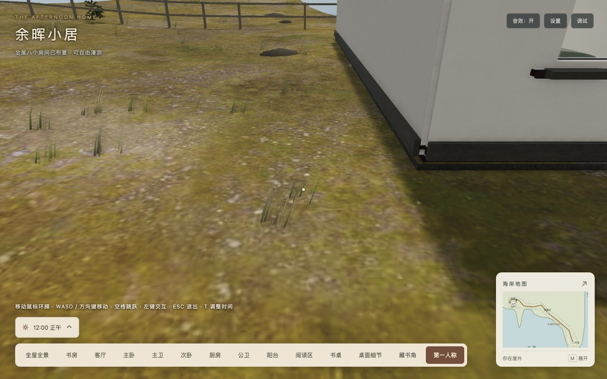
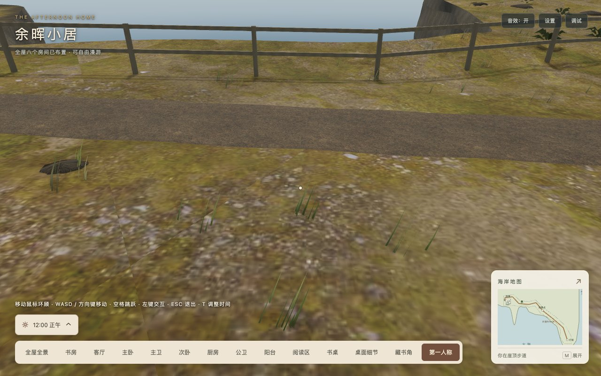

# 室外挡路矮石块移除验收

日期：2026-10-20。实施基线`82a7657`，对应[技术方案](../../2026-10-20-remove-coastal-obstacles.md)。

`CoastalScatter`原先为露出地面超过0.18m的13块低矮散石建立大半径圆形障碍，人物和小电驴共用查询。[原提交查询](before.json)确认屋侧`(-1.204,-0.599)`、路侧`(-24.738,8.232)`均拒绝步行/骑乘；其他11处在可探索边界外。

本轮同步删除13块实体和圆形障碍缓存/查询，保留原随机数消耗顺序。近宅散石顶点2,835→2,250（减少585），四区草木完整几何摘要不变，[几何记录](geometry.json)可复核。更小且原本不阻挡的贴地碎石保留；未修改地形、边界、材质、灯光、运行素材、依赖或车速/转向。

[199项测试](tests.log)、[类型检查](typecheck.log)、[开发构建](development-build.log)、[生产构建/自动发布校验](production-build.log)通过。新增两项回归覆盖原石块几何消失、植物保持、两处双向穿越及安全下车。原护栏/塔基/住宅、全路线支撑和长帧测试继续通过；Webpack保留3类既有建议告警。

[Chrome生产浏览器记录](browser.json)用真实W/E/Space/M事件与固定参考时步检查4次步行、4次骑乘穿越，两处都越过完整原障碍范围。3处高速长帧继续阻挡护栏、塔基和住宅；地图暂停、空格刹车与安全下车通过，无页面/控制台错误、警告或404。位置由夹具设置，段内连续输入推进，无瞬移；时步为功能参考值，不是帧率或旅行耗时测量。脚本迭代修正了步行截图中车辆夹具停位及提示刷新，最终脚本/截图/结果一致，生产代码未因此改变。

[独立发布记录](release.json)仅托管最终`dist`，根路径与`/home/`各495文件GET/原始字节/SHA256通过，包含所有动态分包、说明和清单自身。[完整清单](release-manifest.json)与[依赖分析](bundle-analysis.json)保留字节口径，36运行素材摘要完全不变。

| 指标 | 本轮 | 预算 |
| --- | ---: | ---: |
| 两目标GLB | 4,332,840字节 | ≤4.25MiB |
| 36运行素材 | 15,867,377字节 | ≤16MiB |
| 静态初始JS | 2,692,572字节（-147） | ≤3MiB |
| 实际首屏JS，含必需异步/音频预热 | 2,911,424字节 | ≤3MiB |
| 完整发布目录 | 42,324,467字节（-147），495文件 | ≤41MiB |

本轮专项浏览器检查限Chrome，未重做全程旅行、全部住宅交互或跨平台验收；原证据保留历史语境。未开展FPS/加载耗时实验，不从顶点/字节减少推断性能收益。

复跑：以仓库根目录运行`npm test`、`npm run typecheck`、`npm run build`、`npm run build:production`。使用`../coastal-cliff-d-2026-10-18/serve-dist.py --port 8213`只托管`dist`；设置`PLAYWRIGHT_PACKAGE`为已安装Playwright路径、`STUDY_URL`为托管根URL，运行本目录`check-browser.cjs`与`check-release.cjs`。浏览器通过既有CDP辅助捕获生产对象，没有向交付包增加调试接口。
