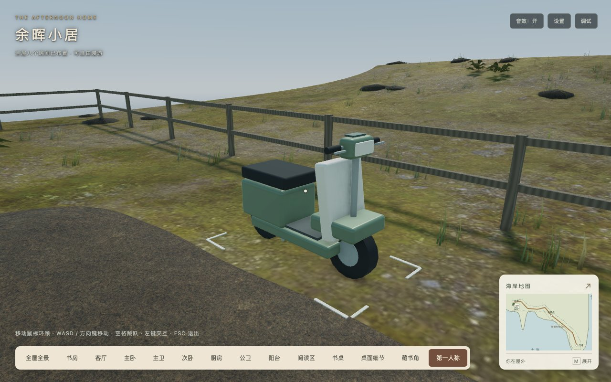
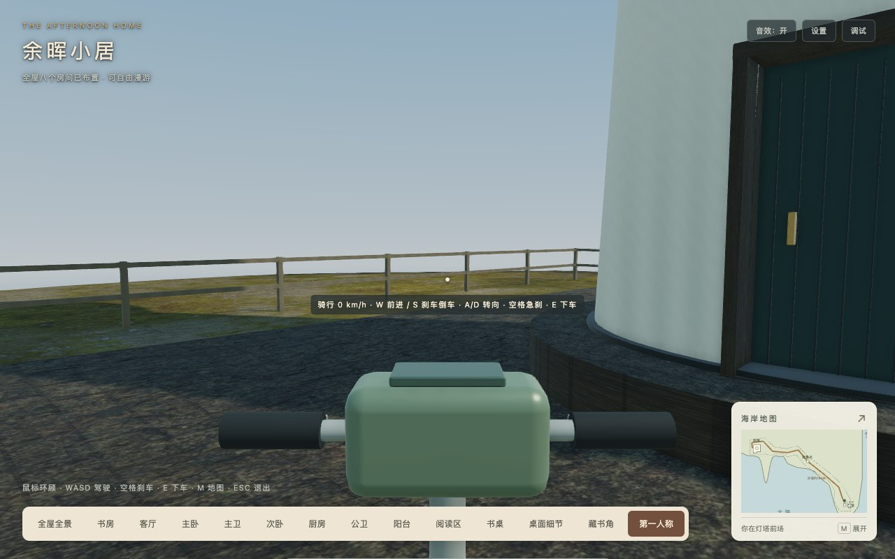
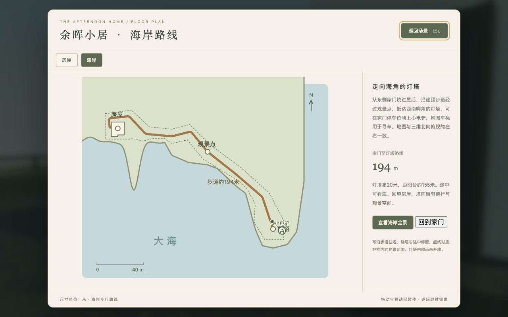

# 海岸小电驴 V1～V3 验收

2026-10-18，运行基线`f2acb80`（灯塔A～D），对应[载具方案](../../2026-10-18-coastal-electric-scooter.md)。V1～V3功能、工程和当前可用环境验收完成。新增原创程序车体、独立米制控制器、安全上下车、三处停车标识、暂停恢复及海岸地图车标；道路、房屋/灯塔和原步行速度保留。

2026-10-18后续调参：最高速度改为40 km/h、A/D转向偏航响应降低50%，见[调参验收](../coastal-scooter-tuning-2026-10-18/README.md)。本目录的5米/秒巡航、45.63/48.05秒和146项测试保留为调整前历史，不与调参后数据混写。

## 工程与发布

[146项测试](tests.log)、[类型检查](typecheck.log)、[临时开发构建](development-build.log)、[生产构建](production-build.log)及自动发布校验通过。Webpack保留三类既有体积建议告警。沿用pure导入/既有builder和注册，没有引入物理引擎、下载素材、纹理、灯、相机或阴影目标。

| 指标 | 本轮 | 灯塔D增量 / 预算 |
| --- | ---: | --- |
| 两目标GLB | 4,332,840字节 | 0 / ≤4.25MiB |
| 36运行素材 | 15,867,631字节 | 0 / ≤16MiB |
| 静态初始JS | 2,631,966字节 | +14,611 / ≤3MiB |
| 实际首屏JS，含必需异步与音频模块 | 2,850,818字节（12JS） | +14,611 / ≤3MiB |
| 完整生产目录 | 42,254,153字节，495文件 | +14,903 / ≤41MiB |
| 场景 | 647网格 / 563,558顶点 / 92材质 / 147纹理 / 16灯 / 3相机 | +7网格 / +3,798顶点 / +2材质，其余0 |

车体6网格与停车标识1网格合计3,798顶点，低于5,000顶点/10网格/2材质分配。2个TransformNode由场景级载具所有者管理，不属于房间重建/销毁；几何、所有权与两轮独立创建/销毁由单测保护。车漆/橡胶复用室外HDR及日光和失败降级；明确排除室内补光，释放时清理所有灯光的包含/排除引用。室外含载具共157,650顶点，低于原160,000目标。接收现有阴影，不进入静态投射列表，因此没有持续刷新1024²阴影图；这是明确的视觉取舍，车体靠原SSAO和真实轮面支撑落地。程序几何为项目原创，无新增第三方素材或许可声明；三项历史素材授权未核实状态不变。

[发布核验](release-check.json)、[完整清单](release-manifest.json)和[依赖分析](bundle-analysis.json)包含所有动态分包、说明及清单自身。根路径和`/home/`各495文件GET/原始字节/SHA256通过，无`public`回退。子路径[Inspector与地图](subpath.json)通过，所有JS来自`/home/`，实际首屏同为2,850,818字节。只读托管脚本复用[原生产服务器](../coastal-cliff-d-2026-10-18/serve-dist.py)，本轮端口8178。

## 真实输入往返

[浏览器记录](browser.json)与[日志](browser.log)：Chrome正常渲染循环，Playwright真实W/A/D/Space按键；脚本仅根据路线选按键，途中不赋车辆位置/朝向，不改相机来转向车辆。初次步行接近车辆使用独立定位夹具，不计为真实出屋步行；入户门双向通行另行回归。两程以按E上车至最终停稳计时，包含视点切换、起步、限速与刹停；返程还包含原地调头。另存纯驾驶耗时和驾驶前耗时，避免将不同计时口径混用。

| 路程 | 时间 | 支撑采样 | 转向按键启动次数（A / D） |
| --- | ---: | ---: | ---: |
| 家门停车位 → 灯塔前场 | 45.635秒 | 92 | 32 / 51 |
| 灯塔前场 → 家门停车位 | 48.046秒 | 92 | 48 / 38 |

两程均达到40～50秒目标，纯驾驶分别为45.064/45.407秒，驾驶前上车/调头为0.571/2.639秒；实骑约183～184米，端点为家门停车位和塔前场，194.07米步道设计长度包含门洞起点与不可驶入的塔基中心，不将两者混为同一口径。记录含各采样的限速值；A/D次数是引导脚本多次微调，不能解释为道路弯道数量。低速停稳后真实A键调头，S键刹车/低速倒车、空格只刹车另见状态专项。184个沿途样本完整轮距/车宽/角点支撑通过，没有穿地/越界。下车有效落脚、跳跃恢复、地图引线车标、地图持键暂停、新按键恢复、预设返回骑乘与主动回家归还人物/车辆通过。

## 状态、边界与原功能

[状态专项](state.json)采用生产控制器与真实键盘事件，长帧使用明确的固定参考delta，不作为旅行/FPS实验：左键上车、E下车、鼠标环顾不改车向、0.25/3步行倍率不改变5米/秒巡航、S倒车/空格刹车、无安全落脚点时留在车上并提示、设置/地图/指针锁定/预设恢复、失效坐标回家、FOV保留及重复销毁通过。窗口blur和visibility为合成事件，不能代替真实OS后台/物理设备；各帧最多0.2秒并细分1/120秒，平移与转向扫掠，前方缺支撑先降速。车辆拒绝房屋、入户门外开扫掠区、塔基、长椅、岩石及护栏外区域；停放车不阻挡人物。

[原室内回归](regression/browser.json)：8抽屉、8灯、7铰链门/推拉门、55段室内路线、地图/信件/设置、轨道缩放、Inspector、缺家具降级和销毁通过。此轮回归明确检查7个场景级载具网格及2个所有者节点，同时保留其他房间所有权断言。两卫镜面实际像素隐藏/恢复一致，见[主卫](mirrors/master/mirror-map.json)、[公卫](mirrors/public/public-mirror.json)；复用历史脚本的baseline字段是套件来源，本轮运行URL/字节以本目录发布清单和请求为准。

[外开门回归](entry/browser.json)保留双向键盘通行/关闭阻挡/门外遇人暂停恢复和地图符号；[15组长帧边界](edge-cases.json)保留窗/栏杆/塔基阻挡、家具走下和空中地图暂停。[故障降级](faults.json)主动中断两种室外资源，预期5次网络错误单列，室内HDR保持、路面/塔体及车体降级检查独立记录。正常套件无运行/着色器错误、警告或404。

## 平台与复跑

[Chrome155 / WebKit26.5矩阵](engines/matrix.json)：1280×800、390×844、844×390，各DPR1/2，共12组合；车体近景/材质、驾驶眼位固定镜头、地图车标和销毁通过。竖屏只后移眼位，FOV不变；[实际骑乘提示布局](state.json)另外检查横竖屏边界。矩阵是工程镜头/支撑检查，实际指针锁定驾驶只计Chrome；WebKit完整键盘驾驶、Firefox/Safari和物理设备本轮未验。FPS、GPU耗时、峰值显存和加载耗时实验继续暂停；字节增量和骑行时间均不扩写为这些指标收益。

浏览器脚本读取`PLAYWRIGHT_PACKAGE`、`STUDY_URL`；WebKit另需`PLAYWRIGHT_BROWSERS_PATH`（本机`/tmp/study-audio-test-browsers`）。镜面复用灯塔D脚本，需将`STUDY_CHECK_OUTPUT`分别设为本目录`mirrors/master`和`mirrors/public`。控制器加载器和CDP对象捕获复用D目录，托管产物未插入测试接口。工程日志仅规范空白，不隐藏告警；异常资源测试和镜头夹具的边界如上所述。
