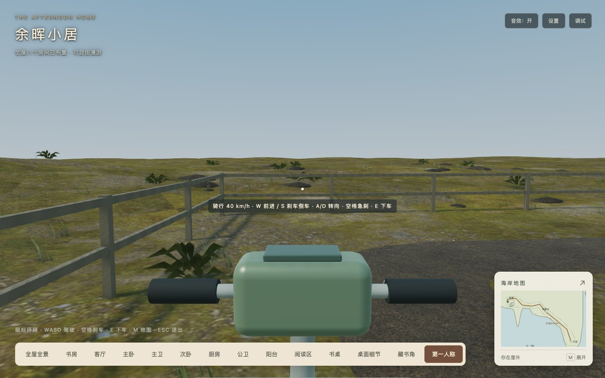

# 小电驴取消限速区验收

2026-10-19，基线`1e2025e`（运行功能包含五层灯塔/垂直梯）。按用户要求取消家门、观景点、灯塔停车区、急弯区域限速，以及前方1.3米探测触发的预减速；有效可骑行区域统一以现有40 km/h为前进目标。对应[载具方案第10节](../../2026-10-18-coastal-electric-scooter.md)。

控制器删除慢速常量、弯道/距离查询及预减速分支。转向0.5、加速/滑行/手动刹车/倒车、完整车身支撑/碰撞扫掠、安全下车和暂停逻辑保持。未改变路线、几何、材质、纹理、灯、相机、下载素材、依赖或预算。

[162项测试](tests.log)、[类型检查](typecheck.log)、[开发构建](development-build.log)、[生产构建](production-build.log)及自动发布校验通过。新增回归覆盖6类原限速位置的40 km/h速度保持、从3 m/s继续加速及最高速度长帧阻挡；原40 km/h/半灵敏度、刹车倒车和资源释放测试继续通过。Webpack保留三类既有建议告警。

[Chrome生产检查](browser.json)用真实W/Space/S/E/M按键，位置/初速度为隔离夹具、积分使用明确的参考delta，不宣称本轮进行了全程实骑计时或FPS测量。家门/观景点/塔前停车位、两处急弯和边缘预减速位置共6例均维持11.111… m/s，HUD显示40 km/h；各位置从3 m/s能继续加速。护栏、塔基、住宅3例以最高速度和0.2秒参考帧冲向障碍后有效停住且仍有完整支撑。空格急刹、低速倒车、地图暂停、安全下车和Inspector加载通过，无页面错误、警告或4xx响应。浏览器专项限Chrome，本轮未重跑完整往返/平台矩阵/灯塔或住宅专项，原证据保留历史语境。

[发布核验](release-check.json)在只托管最终dist的服务器（端口8183，无public回退）通过根路径和`/home/`各495文件GET/原始字节/SHA256，包含全部动态分包和说明。[完整清单](release-manifest.json)及[依赖分析](bundle-analysis.json)保留完整字节口径：

| 指标 | 本轮 | 相对基线 / 预算 |
| --- | ---: | --- |
| 两目标GLB | 4,332,840字节 | 不变 / ≤4.25MiB |
| 36运行素材 | 15,867,631字节 | 不变 / ≤16MiB |
| 静态初始JS | 2,649,623字节 | -521 / ≤3MiB |
| 实际首屏JS，含必需异步及音频 | 2,868,475字节（12JS） | -521 / ≤3MiB |
| 完整发布目录 | 42,272,518字节，495文件 | -521 / ≤41MiB |

原40～50秒设计目标及后续32.96/28.95秒记录均属于历史版本，本轮不推断新的往返时间、加载速度或FPS收益。所有暂停性能实验保持暂停。

复跑使用`PLAYWRIGHT_PACKAGE`指向已安装Playwright、`STUDY_URL`指向独立托管dist，执行本目录`check-no-zones.cjs`和`check-release.cjs`；捕获生产对象和源码查询复用灯塔D测试辅助，未向交付包插入接口。
