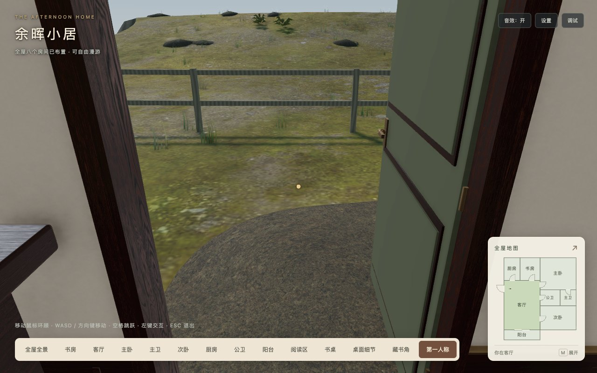
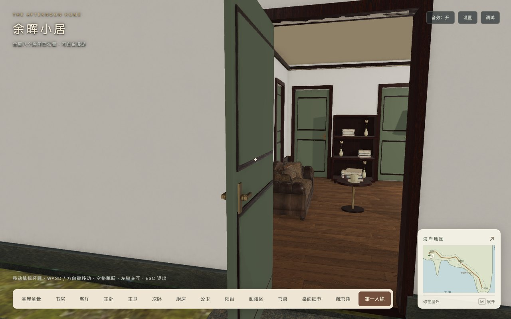
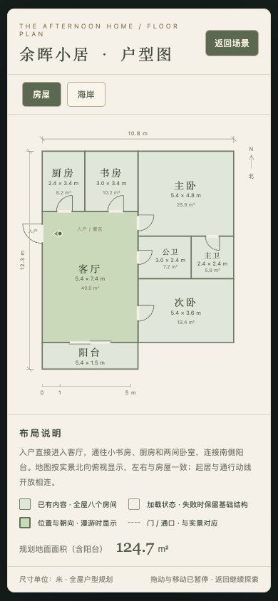

# 入户门外开修正

2026-10-18，基线`d3d64dd`。根据用户要求，将东墙入户门由向客厅内开改为向屋外东侧开90度，保留原铰链、门洞、碰撞、音效和开合控制器。共享`HouseLayout`开向同时驱动三维门扇与大小地图；小地图按实际开门端点扩大viewBox，保留外侧边距，定位坐标和房屋尺寸不变。

[141项测试](tests.log)、[类型检查](typecheck.log)、[开发构建](development-build.log)、[生产构建和发布校验](production-build.log)通过。新增测试验证开门全过程的实际门扇中心位于外墙东侧、门外扫掠阻挡/室内让开方向，以及大小地图开门符号不被裁切；原门与其他场景测试保持。生产构建保留三类既有Webpack建议告警。

[Chrome浏览器检查](browser.json)使用独立生产dist、1280×800、DPR1、禁用缓存：真实点击从室内开门，真实W键出门/返回，从外侧关门，关闭后W键不能进入；玩家在门外弧线内开门时停在进度0.2857，持续渲染不再前进，移开后完成打开。所有移动帧核对实际地面支撑，无穿地或悬空。桌面/390×844/844×390的大小地图与外开符号可见，正常用例无运行/着色器错误、警告或404。本轮为Chrome及桌面模拟尺寸，其他引擎/实机未验；固定参考帧不作为FPS或旅行时间测量。

场景640网格/559,760顶点/90材质/147纹理/16灯/3相机与基线不变。36素材和两目标GLB的摘要不变，无新增素材、依赖或预算调整。

| 指标 | 基线 | 最终 | 变化 |
| --- | ---: | ---: | ---: |
| 静态初始JS | 2,617,031字节 | 2,617,355字节 | +324 |
| 实际首屏JS，含必需异步/音频预热 | 2,835,883字节 | 2,836,207字节 | +324 |
| 完整发布目录 | 42,238,926字节 | 42,239,250字节 | +324 |

全部维持3/41MiB预算，素材维持16MiB预算。[发布清单](release-manifest.json)、[初始依赖](bundle-analysis.json)及[独立托管记录](release-check.json)保存最终结果；根路径与`/home/`各495文件GET/字节/SHA256通过，白名单外资源404，没有public回退。原灯塔C与海岸v1证据未覆盖，后续提交可由本文件Git历史追溯。

复现：运行`npm test`、`npm run typecheck`、`npm run build -- --output-path /tmp/babylon-entry-outward-development`、`npm run build:production`。只托管dist后，设置`PLAYWRIGHT_PACKAGE`指向已有Playwright和`STUDY_URL`为服务地址，运行本目录`check-entry.cjs`与`check-release.cjs`。浏览器脚本复用灯塔C的只读调试夹具以设置独立测试起点，未替换托管生产JS，开关和进出由真实鼠标/键盘输入完成。

