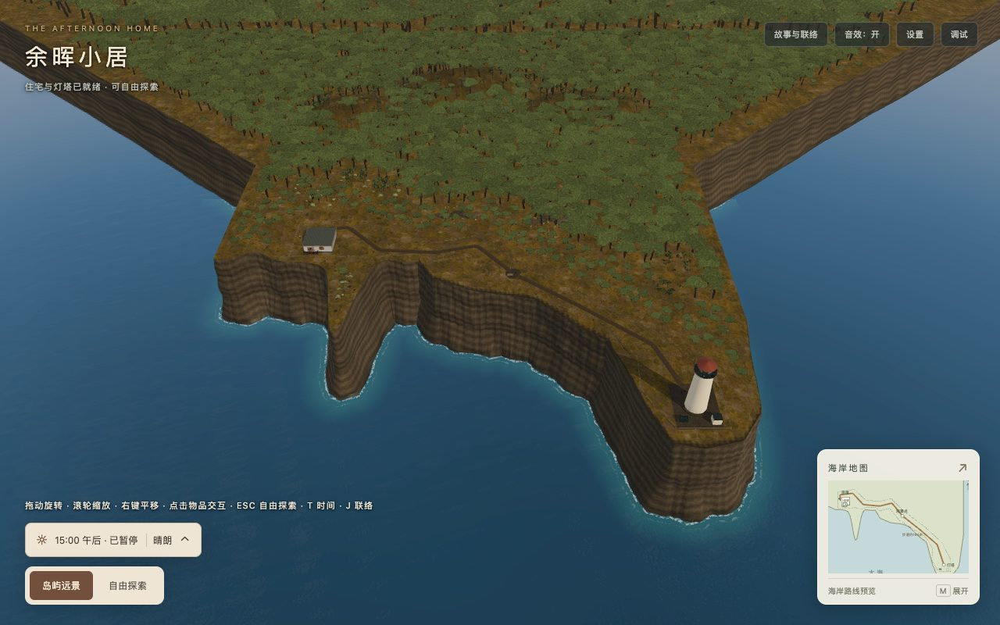

# 海岛植被覆盖与整树替身验收

日期：2026-10-23；代码基线`554fc99`。[实施方案](../../2026-10-23-island-forest-coverage.md)。提交目的：`增加海岛植被覆盖与整树LOD`；提交标识见本目录Git历史及任务回复。

## 实际画面

新增4,267棵树、464丛灌木，保留原88棵及全部丘体、草石。树木主体铺在不可达区域，前部林缘降低为灌丛，路肩、建筑和地标视线留空。下图来自最终生产包，无后期美化。



- 同机位全景：[之前](before/overview-1280.jpg)、[之后](after/overview-1280.jpg)、[窄屏](after/overview-390.jpg)、[横屏](after/overview-844.jpg)。
- [屋后近景](after/entry-1280.jpg)、[塔后林地](after/tower-grove-1280.jpg)、[外廊俯视](after/gallery-1280.jpg)、[垂直鸟瞰](after/lod-bird.jpg)。
- [缩近](after/lod-near.jpg)、[缩远](after/lod-far.jpg)验证原树LOD；9组中低模分别选中0组、6组，鸟瞰选中2组。
- 屋后：[正午](after/weather-entry-noon.jpg)、[日落](after/weather-entry-sunset.jpg)、[午夜](after/weather-entry-night.jpg)、[雾](after/weather-entry-fog.jpg)、[雨](after/weather-entry-rain.jpg)。同样保留五天气的全景截图。

交叉整树片与起伏冠顶仍是简化表现，近看会有单一轮廓重复、片状感及按组离散LOD切换；原近树继续使用分枝/叶簇几何。未增加风摆或动态树影，未声明照片级还原或美术已获用户确认。

## 覆盖采样

[脚本](check-coverage.py)从当前源代码生成植被分布，以实际PNG冠顶alpha≥0.35的平面投影并集统计，重叠只算一次；两张竖直整树片没有平面面积。不将包围盒、染绿地面或树数量计作覆盖。原88棵和既有地面草木未计入，为保守统计。

| 区域 | 陆地覆盖（含道路/空地） | 可种植区域覆盖 |
| --- | ---: | ---: |
| 全岛 | 74.62% | 75.25% |
| 前部，平面Y≥−180m | 63.55% | 67.91% |
| 路线附近，平面Y≥−50m | 38.95% | 49.97% |

可种植区域扣除步行区及3m缓冲、地标线及1m缓冲；实际陆地边界与遮罩按[0.5m采样](coverage-0.5m.json)，[1m复核](coverage-1m.json)全岛覆盖差异小于0.1个百分点。属于平面采样估计，不是坡面或生态调查，也不是每个镜头的画面占比。[覆盖图](coverage-0.5m.png)：绿为新增冠层、棕为裸地、浅色为受保护空间、蓝为海。前部刻意比后部更疏，不能用全岛75%描述前部密度。

## 素材与结构成本

从现有CC0派生叶簇/树皮和ISC原创树几何烘焙正视、侧视、冠顶，512×256 PNG为22,291 B。[来源](../../../../public/textures/coastal/pine-impostor-source.json)记录原叶簇、树几何SHA256及参数；[烘焙脚本](../../../../tools/bake-coastal-tree.py)使用Pillow 12.3.0、Numpy 2.3.5及当前Node/TypeScript源码加载器，[确定性重建](atlas-check.log)通过。上游作者、CC0原件固定URL及摘要沿用[叶簇来源](../../../../public/textures/coastal/pine-source.json)，未导入整树高模或外部植被库。

材质为sRGB、alpha test 0.35、双面、共用原昼夜PBR环境；预烘焙只有中性形态明暗，没有固定太阳/投影。每株两张交叉整树片加四面浅冠顶，共13顶点/8三角形；首轮6三角平顶在斜俯视像薄片，因此增加中心点与2个三角形，并修正顶视UV。

| 结构 | 基线 | 当前 |
| --- | ---: | ---: |
| 景观网格（含LOD备份） | 19 | 122 |
| 景观顶点（含LOD备份） | 10,153 | 72,800 |
| 景观三角形（含LOD备份） | 10,416 | 48,968 |
| 原海岸及景观顶点 | 165,829 | 228,476 |
| 全场景存储顶点 | 585,551 | 648,198 |
| 场景网格/材质/纹理 | 735 / 110 / 154 | 838 / 111 / 155 |

新林地94个80m空间块，61,503顶点/37,848三角形；原树的9组LOD备份另1,144顶点/704三角形。旧近树单株81顶点/62三角形、旧远树60顶点/46三角形；替身8三角形比旧远树少82.6%，只说明几何量差异。新增透明覆盖、材质与空间块仍有开销，不等同于FPS提升。全场景引擎`getTotalVertices()`只报647,054，少于含备份的648,198；预算使用完整存储几何。

原166,000顶点/15,000景观三角形预算无法容纳新增大面积林地，按实施前方案与[资源原则](../../../resource-optimization-principles.md)更新为250,000顶点/55,000三角形；旧几何仍单独保护。22灯、3相机、19带阴影灯保持；新增林地不拾取、不碰撞、不投影，无每棵逐帧回调。

## 工程与生产检查

[422测试](tests.log)、[森林专项](forest-tests.log)、[类型](typecheck.log)、[开发构建](development-build.log)、[生产构建/校验](production-build.log)通过。新增测试保护整个树冠外廓、连续三角面的路线避让、实际地面/丘体射线支撑、16条地标视线、LOD选择、包含备份的预算、共享材质、失败降级、显隐/释放。固定种子231029；新树完整外廓距路线最小3.209m。陡峭丘面Float32上传产生约0.1mm差异，根部支撑容差1mm；未改动地形掩盖差异。

[浏览器脚本](check-browser.cjs)独立托管完整生产目录；Chrome/DPR1、冷缓存，九机位×1280×800/390×844/844×390共27组[前](before/browser.json)/[后](after/browser.json)姿态相同。另存10张天气截图、3张LOD/鸟瞰截图，远近切换、拖动缩放、地图、设置/重置和Inspector通过。正常路径无运行/着色器错误或404；保留原Inspector CSS弃用提示、Webpack三条体积建议。

两种资源失败单独验收：原叶簇失败时隐藏其9个原树组；新整树图失败时隐藏其103个网格并解除9个LOD链接，原88棵细节、地形和操作仍可用，不暴露不透明卡片。[移动脚本](check-movement.cjs)及[结果](movement.json)用原生键盘事件与60Hz参考步进验证速度比1.3、默认/最高倍率护栏阻挡及设置重置；不是FPS或完整旅程耗时实验。

| 指标 | 554fc99 | 当前 |
| --- | ---: | ---: |
| 两目标GLB | 4,332,840 B | 4,332,840 B |
| 运行素材 | 16,132,604 B（37件） | 16,154,895 B（38件） |
| 静态初始JS | 2,922,227 B | 2,925,734 B |
| 实际首屏JS（含12个必需请求） | 3,140,717 B | 3,144,224 B |
| 完整发布目录 | 42,926,938 B（498件） | 42,958,086 B（500件） |

3MiB首屏预算余1,504 B、41MiB完整发布余33,530 B，四项原字节预算不变。根与`/home/`各500文件GET/字节/SHA256通过；[完整清单](after/release-manifest.json)包含全部动态分包/来源。原37件运行素材摘要与分包集合不变。[复核脚本](check-evidence.cjs)及[几何/字节/源码摘要](geometry-and-release.json)保存一致性证据，浏览器和移动检查针对同一个发布清单摘要。

## 复现与边界

在项目根目录执行：

```sh
python3 tools/bake-coastal-tree.py --check
python3 docs/technical-plans/assets/island-forest-2026-10-23/check-coverage.py 1
python3 docs/technical-plans/assets/island-forest-2026-10-23/check-coverage.py 0.5
npm test
npm run typecheck
npm run build
npm run build:production
node docs/technical-plans/assets/island-forest-2026-10-23/check-browser.cjs
node docs/technical-plans/assets/island-forest-2026-10-23/check-movement.cjs
node docs/technical-plans/assets/island-forest-2026-10-23/check-evidence.cjs
```

Python需上述固定版本Numpy/Pillow；浏览器脚本使用本机Chrome与现有Playwright运行时，可用`PLAYWRIGHT_PACKAGE`覆盖位置，不增加项目依赖。基线设置`LANDSCAPE_BASELINE=1 LANDSCAPE_DIST=<554fc99生产目录>`；基线包不含新图集/代码。

性能采样继续暂停，未验证FPS、加载速度或“无性能影响”。其他浏览器引擎、物理移动设备和全程原生步行/骑行往返本轮未验。上述结构/字节、截图、抽样面积与交互验收不扩展成这些结论。
