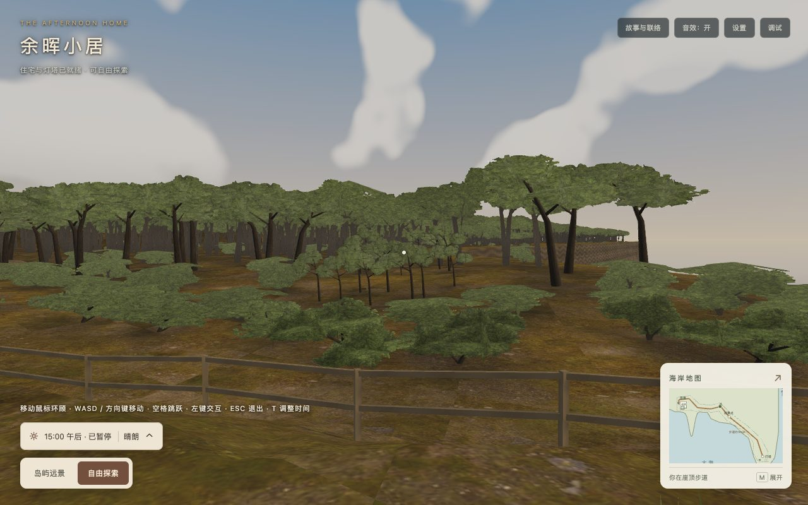

# 林下静态遮蔽验收

日期：2026-10-23；基线`bfe0c62`。[技术方案](../../2026-10-23-island-forest-grounding.md)。`before/`保存基线生产包的既有记录，`after/`为本轮最终包；相机逐项核对。截图是实际游戏画面，没有将生成示意图用作效果证据。

## 画面对比

| 机位 | 优化前 | 优化后 |
| --- | --- | --- |
| 塔旁林缘 | [1280×800](before/tower-grove-1280.jpg) | [1280×800](after/tower-grove-1280.jpg) |
| 入口林地 | [1280×800](before/entry-1280.jpg) | [1280×800](after/entry-1280.jpg) |
| 全岛 | [1280×800](before/overview-1280.jpg) | [1280×800](after/overview-1280.jpg) |
| 手机竖屏 | [390×844](before/tower-grove-390.jpg) | [390×844](after/tower-grove-390.jpg) |



九机位×三画幅共27对；另有10张昼夜/雾雨截图、三张近远缩放/鸟瞰、[镜面](after/public-mirror.jpg)及[地面颜色贴图失败降级](after/ground-fallback.jpg)。地面暗部与植被布局对应，边缘平滑，住宅空地和原有步道保留；没有方向性长树影。近景改善不能扩写为每一棵远树都有精确接触阴影。

## 工程与成本

[基线结构](structure-before.json)来自固定提交源码的NullEngine实例；[当前结构](structure-after.json)逐项对照全部外景网格位置/索引/法线/UV、非地面颜色、资源数量及原投影名单。7个地面网格修改已有23,273组RGB，颜色缓冲仍372,368 B，无新增元素。完整场景仍850网格、111材质、155纹理、22灯、3相机、19个带阴影灯，含全部LOD备份的655,731存储顶点保持。

空间桶只在创建时使用，4,819株对应939,517次候选距离求值；逐顶点遍历全岛则为112,152,587次。两者是算法查询量对照，不是耗时实验。每帧无新增树木遍历、纹理采样、绘制批次或阴影刷新。额外初始化和临时索引仍有成本。

用实际三角面射线命中及重心插值检查根下颜色：原88棵相对原底色平均倍率0.563，93株近景细节为0.430；远林按序每40株抽样119株平均0.532。数值是线性颜色倍率，不是像素亮度或物理光照测量。共享顶点颜色一致、住宅空地保持白色倍率、alpha保持1；时刻/显隐操作不会重算或移动暗斑。远处网格仍可能漏掉小树根。

| 字节指标 | 基线 | 本轮 | 原预算 |
| --- | ---: | ---: | ---: |
| 两目标GLB | 4,332,840 | 4,332,840 | 4,456,448 |
| 运行素材 | 16,177,230 | 16,177,230 | 16,777,216 |
| 实际首屏JS（含必要异步） | 3,145,334 | 3,145,708 | 3,145,728 |
| 完整发布 | 42,984,733 | 42,987,017 | 42,991,616 |

实际首屏12个JS请求，500发布文件，所有38个运行素材及动态分包集合保持。静态初始JS2,927,218 B不替代实际首屏；首屏余20 B、完整发布余4,599 B。新增JS净374 B，发布净2,284 B，包含说明文件与分析清单。两份已有GLSL字面量压缩空白，词元摘要与基线相同；没有删除画面效果、分包或来源来换预算。

## 检查与复现

[全量测试](tests.log)426项、[专项测试](shade-tests.log)3项、[类型](typecheck.log)、[开发构建](development-build.log)、[生产构建](production-build.log)通过。保留Webpack三条体积建议。

[浏览器记录](after/browser.json)、[发布清单](after/release-manifest.json)与[移动记录](movement.json)使用同一最终包。根路径及`/home/`各500文件GET/字节/SHA256、27对固定相机、昼夜天气、LOD、镜面就绪、地图/设置/Inspector/轨道操作、护栏及三种贴图失败降级纳入验收。[综合校验](verification.json)核对最终清单、相机、完整场景结构与所有运行素材摘要。

从项目根目录执行；浏览器脚本默认使用本机Chrome及已有Codex `playwright-core`，可通过`PLAYWRIGHT_PACKAGE`指定现有模块，未添加依赖。截图采用DPR 1、固定姿态和手动渲染；移动为原生键盘事件配合60Hz参考步进，不是FPS或全程步行/骑行测量。

```sh
npm test
npm run typecheck
npm run build
npm run build:production
node docs/technical-plans/assets/island-grounding-2026-10-23/check-structure.cjs
node docs/technical-plans/assets/island-grounding-2026-10-23/check-browser.cjs
node docs/technical-plans/assets/island-grounding-2026-10-23/check-movement.cjs
node docs/technical-plans/assets/island-grounding-2026-10-23/check-evidence.cjs
```

正常加载路径不得出现运行/着色器错误或404；原Inspector CSS提示单独保留。只验收本机Chrome，其他引擎和物理设备未测。静态遮蔽不随太阳移动、不产生准确枝叶投影；性能采样保持暂停，不声称实测加载加速或FPS收益。
