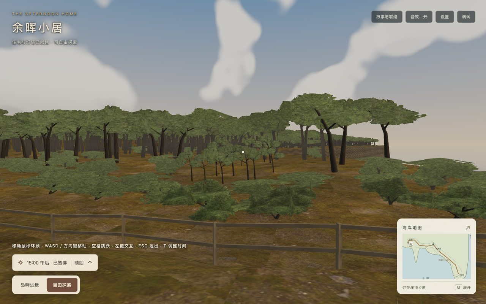

# 林缘树形与近远过渡验收

日期：2026-10-23。基线：`3df3fc1`。[技术方案](../../2026-10-23-island-forest-refinement.md)。本阶段完成静态树形优化；风摆、动态树影及FPS/加载时长采样不在本次验收内。

## 实际画面

下列均为生产包Chrome截图，DPR 1，相同镜头与天气。`before/`复用基线提交的上一轮生产验收记录；`after/`来自本轮最终发布清单。九个机位、三种画幅共27对，相机参数逐项一致。

| 场景 | 优化前 | 优化后 |
| --- | --- | --- |
| 塔旁林缘 | [1280×800](before/tower-grove-1280.jpg) | [1280×800](after/tower-grove-1280.jpg) |
| 入口树丛 | [1280×800](before/entry-1280.jpg) | [1280×800](after/entry-1280.jpg) |
| 全岛 | [1280×800](before/overview-1280.jpg) | [1280×800](after/overview-1280.jpg) |
| 手机竖屏林缘 | [390×844](before/tower-grove-390.jpg) | [390×844](after/tower-grove-390.jpg) |



另有10张全景/入口昼夜天气截图，以及[近景缩放](after/lod-near.jpg)、[远景缩放](after/lod-far.jpg)、[鸟瞰](after/lod-bird.jpg)、[公共区域镜面](after/public-mirror.jpg)。近、远、鸟瞰测试分别选择0、1、1个低模组；不代表所有实际镜头的选择数量。

## 几何、覆盖与发布

55棵树、38丛灌木使用匹配图集的81顶点/62三角形枝冠，增加6个细节组与6个LOD备份。其余远林继续13顶点/8三角形，图集增加第二种轮廓。原4,731株布局和原88棵树/非树景观摘要保持，详见[几何与发布汇总](geometry-and-release.json)。

| 项目 | 基线 | 本轮 | 预算 |
| --- | ---: | ---: | ---: |
| 海岸及景观顶点（含LOD备份） | 228,476 | 236,009 | 250,000 |
| 景观三角形（含LOD备份） | 48,968 | 54,734 | 55,000 |
| 两目标GLB字节 | 4,332,840 | 4,332,840 | 4,456,448 |
| 运行素材字节 | 16,154,895 | 16,177,230 | 16,777,216 |
| 实际首屏JS字节（含必要异步） | 3,144,224 | 3,145,334 | 3,145,728 |
| 完整发布字节 | 42,958,086 | 42,984,733 | 42,991,616 |

首屏12个JS请求，完整发布500文件；静态初始JS为2,926,844 B，不能替代实际首屏统计。首屏仅余394 B、发布余6,883 B。全场景网格838→850；111材质、155纹理、22灯、3相机、19个带阴影灯不变。总存储655,731顶点包含2,353个LOD备份；引擎当前总数不包含这些备份，不能据此省略预算成本。

[0.5m覆盖采样](coverage-0.5m.json)按真实冠顶alpha及细节三角面做平面并集，全部替身/93株细节全启用两种参考状态的全岛可种植覆盖分别为75.37%/75.36%，陆地覆盖74.73%/74.72%。原88棵和既有地被不计入；可种植区域排除路线及3m缓冲、地标视廊及1m缓冲。与[1m采样](coverage-1m.json)差约0.11个百分点。[覆盖图](coverage-0.5m.png)仅展示全部替身状态。混合LOD镜头不保证严格处于这两个总数之间，面积也不是屏幕覆盖率。

## 检查结果与证据

- [全量测试](tests.log)：423项通过；[林地专项](forest-tests.log)包含稳定布局、实际根位支撑、连续三角边至路线≥3m、16条地标视线、UV/法线、预算、LOD及释放/降级。
- [类型检查](typecheck.log)、[开发构建](development-build.log)、[生产构建](production-build.log)、[确定性图集重建](atlas-check.log)通过。保留Webpack原有三条体积建议。
- [浏览器记录](after/browser.json)与[最终发布清单](after/release-manifest.json)：独立托管根路径和`/home/`分别500文件GET、字节与SHA256一致；27对画面、昼夜天气、LOD、轨道镜头、地图、设置、Inspector、两面512镜面就绪及资源失败降级通过。正常路径无运行/着色器错误和404；保留原Inspector CSS提示。
- [移动检查](movement.json)：最终同一生产清单，原生键盘事件配合60Hz参考步进，默认速度、设置恢复和护栏通过；不作为实时帧率或完整步行/骑行验收。整树图失败保留181株近树细节并移除15个LOD链接；叶簇图失败隐藏15组细节，其余远林与地形保持。

## 复现

从项目根目录执行。Python需NumPy和Pillow；浏览器脚本默认使用本机已装Chrome与Codex附带的`playwright-core`，可用`PLAYWRIGHT_PACKAGE`指定已有模块。未新增项目依赖。浏览器脚本自行托管未经修改的生产`dist`，并关闭计时相关采样；截图使用固定姿态和手动渲染。

```sh
npm test
npm run typecheck
npm run build
npm run build:production
python3 tools/bake-coastal-tree.py --check
node docs/technical-plans/assets/island-refinement-2026-10-23/check-browser.cjs
node docs/technical-plans/assets/island-refinement-2026-10-23/check-movement.cjs
python3 docs/technical-plans/assets/island-refinement-2026-10-23/check-coverage.py 1
python3 docs/technical-plans/assets/island-refinement-2026-10-23/check-coverage.py 0.5
node docs/technical-plans/assets/island-refinement-2026-10-23/check-evidence.cjs
```

实际Python环境为NumPy 2.3.5 / Pillow 12.3.0。最终汇总脚本对比相机、清单、源文件摘要、未改动的37个运行资源、分包集合、几何及覆盖约束。本次只验证Chrome；未测其他引擎、物理设备、FPS及加载时长。远林仍为固定交叉片，近树叶簇仍为卡片，LOD仍按组离散切换；两种轮廓减少重复，但没有消除片状感或实现透明渐变。
