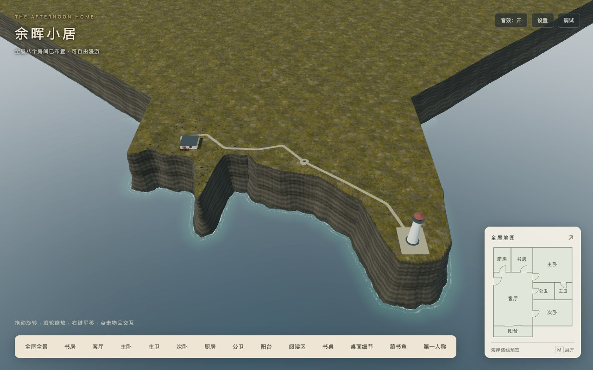

# 灯塔与沿海步道：阶段A空间灰盒验收

日期：2026-10-18。实施基线 `2169624`，对应[灯塔主方案](../../2026-10-18-lighthouse-coastal-path.md)。阶段A已完成，B～D待实施；[原海岸v1](../../../reuse/coastal-cliff-v1.md)及其输入/源码标签/验收未覆盖。

在页面中点击右下地图 → **海岸** → **查看海岸全景**。也可从阳台第一人称向右看灯塔。室外步行仍由阶段B实现，地图已说明当前开放范围；本目录的途中/塔前站姿由工程镜头验证，不代表已经能够正常走过去。



## 已完成的空间

- 灯塔中心平面 `(-125,90)m`，距阳台约154.55米；塔高20米、塔身基径5.6米、石基占位直径7米。塔区地面相对室内+3米，塔前场14×18米，平台顶面再高0.04米。
- 海岸向西延到x=-151米，近岸列间距仍0.8125米；近区行加密到48，远区44行保留。原近宅前沿平面函数保留，西南新岸线与顶部/分层崖壁/水下截面共用边界。
- 家门经屋后、海岸缓弯、观景点到灯塔的圆角路线，三维弧长 **192.937米**，道路宽1.8米，沿线观景长椅为占位。新增房屋简洁屋顶占位，海岸全景/第一人称显示，原房间剖面及半透明全屋全景恢复原规则。
- 地图用同一岸线和路线数据生成，新增“房屋 / 海岸”切换，保留八房户型与面积。海岸图继续采用原三维北向左手投影，左右与实际俯视一致；原方案SVG是地理概念示意，不作为运行地图数据。

## 灰盒发现与调整

1. 原D～E控制点让道路穿过旧崖缘收窄处。D改为 `(-18,10)`、E改为 `(-40,12)`，增加 `(-56,8)` 内陆缓弯；完整路宽及崖缘退距通过测试。塔前场原候选东南角超出陆地，已加宽该段岬角，四角均有水平真实地形承托。
2. 未整平的塔前自然地形局部纵坡约19.6%。使用共享路线标高，在道路两侧3.5米内整平，向8米外平滑回自然坡面，最后14米与塔前水平场地衔接；在实际渲染三角形上采样，主路最大纵坡 **5.118%**，低于8%设计目标。
3. 不能只在连续高度函数上放路面。实际道路按地表三角形插值得到顶点高度，再上移25mm；5,568个道路三角形的面内支撑检查通过，没有面中心埋地/异常悬浮。后续精细路肩/材质过渡由C完成。
4. 沿用房屋145世界单位环绕上限会把海岸镜头拉到崖边。现先扩大海岸视图半径，再应用位置，并调整构图以免灯塔被小地图遮住。海岸全景单独使用近裁面5世界单位，改善远距离薄路面深度精度；房间0.2、第一人称0.1保持。
5. 新岬角必须同步泡沫/水深场。覆盖改为平面x=-180～80、y=-65～155米，尺寸由256²增为512²，保持或提高原近宅采样密度。生成器使用行交点判断内外、线段边界提前排除，输出与精确距离函数比较通过；不据此宣称加载或FPS收益。

## 画面与平台

[Chrome灰盒记录](browser.json)覆盖13个取景：[阳台右转望塔](balcony-right-lighthouse.jpg)、[途中看塔](lookout-toward-lighthouse.jpg)、[途中回望房屋](lookout-back-to-house.jpg)、[塔前回望房屋](lighthouse-back-to-house.jpg)、[灯塔近景](lighthouse-massing-close.jpg)、[旧岸线收窄处](path-original-coast-pinch.jpg)、[海岸地图](coast-map-desktop.jpg)、横竖屏与原阳台预设等。三条地形/崖壁视线射线均无阻挡；目的地建筑不作为遮挡物计入。

[引擎矩阵](engines/matrix.json)为Chrome155.0.8059.82、Playwright WebKit26.5，1280×800、390×844、844×390各DPR1/2，合计12组合通过。验证海面着色器、连续时间推进、屋顶切换、灯塔投影在视口内且未被小地图遮盖、地图/全景和重复销毁；无运行/着色器错误、404或警告。hardware scaling仍为1，DPR截图不代表提高了画布渲染分辨率。

例如[Chrome桌面](engines/chromium-coast-desktop-dpr1.jpg)、[WebKit竖屏](engines/webkit-coast-portrait-dpr2.jpg)、[海岸地图竖屏](coast-map-portrait.jpg)。这是桌面浏览器及手机尺寸模拟，不能称为Safari/iPhone/Android实机验收。Firefox、Safari与物理移动设备本轮未验。

海面连续性使用渲染帧的时间推进验证，另保留原阳台/室内回归；本阶段没有实现新的海浪、灯束或运动系统，截图不能扩大为FPS/加载耗时结论。

## 原有功能回归

[完整Chrome回归](regression/browser.json)通过8抽屉、8灯、7平开门与阳台推拉门、门扇双面交互/扫掠保护、12次双向门洞碰撞、55段全屋路线、真实指针锁定与地图/信件模态恢复、拖动缩放、速度设置及Inspector。异步书架故意失败时，其他房间和基础结构可用，地图定位继续刷新；重复pagehide销毁后网格/材质/灯与引擎场景归零。

[主卫镜面/地图](mirrors/master/mirror-map.json)、[公卫镜面](mirrors/public/public-mirror.json)通过：家具隐藏改变反射像素，恢复后摘要一致，门/灯/相机改变有效，背向/视锥外刷新门控保持。两张512²镜面目标保留，没有新增镜面或海面反射目标。

[跳跃记录](jump/jump.json)保留0.825基础速度、空格起跳/落地、床/沙发/茶几/椅/阳台落点和全景按空格不移动；室外边界未取消。正常回归错误/警告/404为空，故意异步失败另有明确记录。

复用的旧校验脚本在部分JSON内仍带有历史`baseline=d1ae3a1`字段，它表示脚本最初来源，不是本次源码提交。上述脚本本轮均指向8170端口的同一最终生产目录；[本次汇总与来源摘要](acceptance.json)、[发布清单](release-manifest.json)确定本轮实际输入与成品身份。

## 字节、对象与运行成本

全部36个下载素材与[阶段D](../coastal-cliff-d-2026-10-18/README.md)逐字节/SHA256保持；来源说明新增原创灰盒几何、地形整平和岸线场记录。无新依赖、外部模型或图片，pure/精确导入与显式注册沿用，资源白名单和阈值未放宽。

| 指标 | 阶段A最终结果 | 相对阶段D | 硬预算 |
| --- | ---: | ---: | ---: |
| 两目标GLB | 4,332,840字节 | 不变 | 4.25MiB |
| 36运行素材 | 15,867,631字节（15.13MiB） | 不变 | 16MiB |
| 静态初始JS | 2,597,655字节 | +10,600字节 | 3MiB |
| 实际首屏JS，含必需异步 | 2,816,507字节（12JS，2.69MiB） | +10,600字节 | 3MiB |
| 完整发布 | 42,216,937字节（495文件，40.26MiB） | +13,145字节 | 41MiB |

[根路径和`/home/`验收](release-check.json)逐个GET/字节/SHA256通过，包含全部动态调试/编辑器分包、来源/许可和清单自身；白名单外文件返回404，未借`public`补齐。完整发布尚余774,679字节，实际首屏尚余329,221字节；[模块图](bundle-analysis.json)保留实际依赖。

场景628网格/536,160顶点/84材质/147纹理对象/16灯/3相机；相对阶段D为网格+16、顶点+31,529、材质+4。室外32网格/130,228顶点，低于160,000顶点设计目标。新增道路、灯塔和屋顶仍有真实几何/绘制成本；新海岸全景固定姿态记录782次总绘制（含室内、阴影和后期），不同镜头不能直接比较为性能收益。

生成岸线场为512²RGBA8线性纹理、无mip，**1,048,576字节**，较旧256²增加786,432字节（768KiB）；纹理对象数没变不代表显存没增加。沿用一个1024²外景缓存阴影、双卫镜面与原SSAO；A没有为远灯塔增加阴影目标，远处接触阴影细化留到C。未测总显存峰值、GPU耗时、FPS和加载耗时，原暂停实验保持暂停。

## 行走时间与后续范围

用实际UniversalCamera按键配置、0.825基础速度和0.55惯性，在固定60Hz参考步长的无碰撞标尺相机上校准，得到约1.1595米/秒；按192.937米路径推算约166.4秒（2分46秒）。这是一项控制器标尺，不是真实室外行走，也不是帧率测量。原约1～2分钟目标据此调整为约2.5～3分钟的暂定节奏，阶段B以正常输入和实际坡面往返复验，不静默改变室内速度。

阶段B仍需统一支撑/头顶空间控制器、负高度与无支撑处理、门外缓坡、边界/坡面/跳跃、位置恢复和户外实时定位。C补齐近景材质、路肩/石板、护栏/路牌、外屋面细节及分区阴影。D完成最终发布与平台范围；塔内/登塔和天气夜景不在首期。此处没有把工程镜头站位或地图路线当作户外功能交付。

## 复核入口

工程记录：[128项测试](tests.log)、[类型检查](typecheck.log)、[临时开发构建](development-build.log)、[生产构建/自动发布校验](production-build.log)均通过；生产构建保留3类既有Webpack体积/分包建议。

`check-graybox.cjs`与`check-engines.cjs`使用`PLAYWRIGHT_PACKAGE=/path/to/playwright`，后者还可用`PLAYWRIGHT_BROWSERS_PATH`指向已安装运行时；默认本机Chrome及`http://127.0.0.1:8170/`。`check-release.cjs`独立核验最终`dist`。本轮还以相同URL和本目录输出路径复用了原阶段D的`check-regression.cjs`、两个镜面脚本和`check-jump.cjs`，没有改写旧阶段D证据。

验收服务器仅托管最终生产目录，复核可使用：

```sh
python3 docs/technical-plans/assets/coastal-cliff-d-2026-10-18/serve-dist.py --port 8170
node docs/technical-plans/assets/lighthouse-a-2026-10-18/check-release.cjs
```

运行浏览器脚本会重建相应截图/JSON；如需保存本轮证据，先复制到新的日期目录。代码身份以本次Git提交及`acceptance.json`输入摘要追溯，本轮未建立或覆盖新的稳定v1标签。
