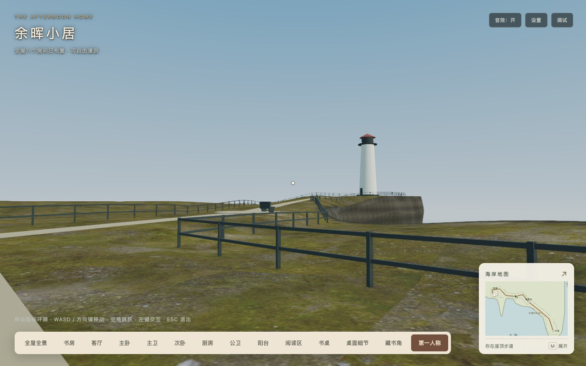
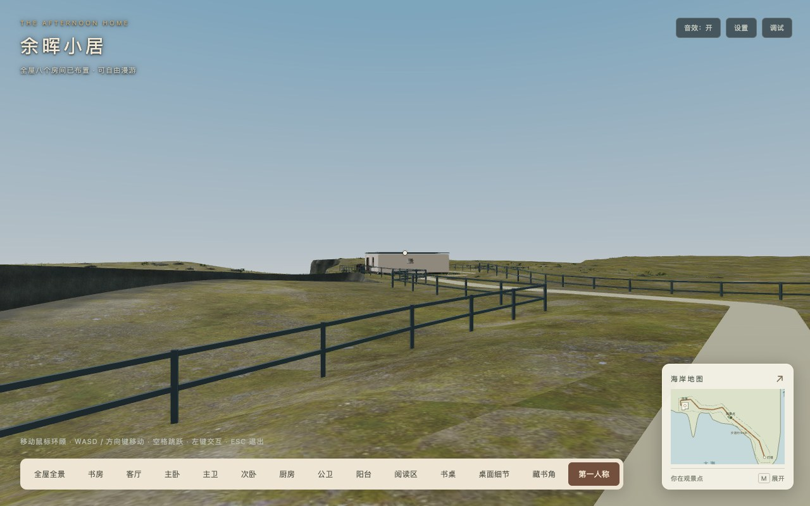
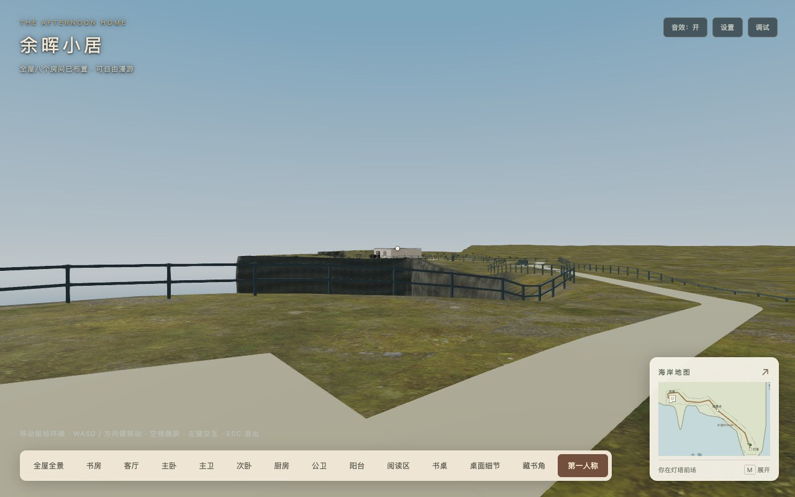
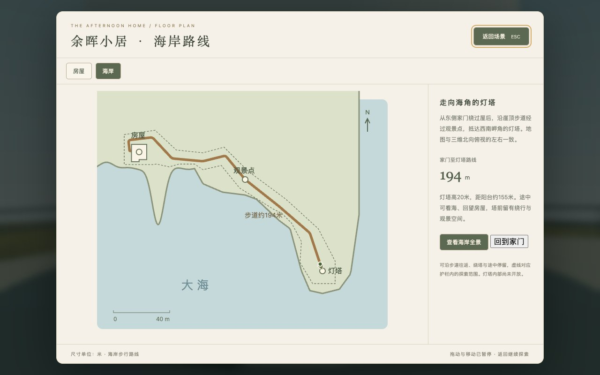

# 灯塔阶段B室内外通行验收

2026-10-18，基于`8110fe7`完成出屋、沿海步道、绕塔及返回。阶段A的灯塔和路线保留为灰盒，阶段C视觉完成与阶段D最终交付待后续实施；本轮没有加入小电驴或塔内游览。

## 体验入口

在第一人称中转向东侧入户门，站在门扇扫掠范围外左键开门，出门后沿步道前往灯塔。也可打开地图，选择“海岸 → 回到家门”到达门外缓坡。小地图会随室内/室外切换，M查看大图，地图返回保持原位置。退出第一人称、切换预设后再进入，会恢复稳定的漫游位置。

## 实际改动

- 新增共享道路/门外缓坡几何和`WalkingSurface`：支撑取渲染地形与路面三角形，以及塔前场、32边观景平台的顶面。保留负高度，不将海面/空缺当作高度0；返回法线、表面类别和区域。
- 移除旧入户门外不可见封锁，保留真实门扇碰撞与扫掠保护。门外先向东走直线，再转向屋后，避免贴门框；长椅移到观景平台路旁。设计中心线从192.94米变为194.07米。
- 护栏与有限探索区域读取同一米制多边形，护栏以一个网格合批。人物半径0.26米，连续移动每10厘米检查支撑/坡度、外墙窗洞、阳台栏杆及塔基/长椅/大石；保护同时覆盖跳跃，不只验证终点。
- 跳跃沿用9.81米/秒²重力、0.72米最大起跳与家具白名单，接入实际地面/局部净高。室外无全局室内天花限制，缓坡/小高差可跟随；没有支撑不会落到虚构地面。
- 保存稳定位置与朝向；地图/设置/查看物品暂停输入，预设返回时复核支撑和当前门扇，异常位置回最近稳定点或门外缓坡。主动回家保留门灯状态。
- 海岸大小地图展示位置/朝向、区域名称和护栏范围；室外打开大图默认海岸，室内继续显示八房高亮与尺寸。

## 真实输入与边界验收

[完整浏览器记录](browser.json)使用Chrome155.0.8059.82、1280×800、DPR1。正常渲染循环与引擎计时下持续按真实W键，仅以脚本转向引导路线，不在路途中设置人物位置。起点为屋内门前，真实左键开门，经过门外缓坡和沿海主路。

| 路段 | 记录时间 |
| --- | ---: |
| 屋内门前到塔前安全位置 | 163.53秒 |
| 绕塔一周 | 28.53秒 |
| 塔前返回屋内门前 | 163.05秒 |

194.07米是家门至塔中心的设计中心线长度；塔基是实体阻挡，实际行走停在塔前。上述时间不含观景停留，是本机无头浏览器自动转向条件下的结果，不代表所有设备或玩家操作时间，也不是FPS/加载耗时测量。每约0.5秒检查实际位置、脚高和支撑，完整往返/绕塔无穿地、悬空或越界。

地图原位返回、切换预设后恢复塔前原位/朝向、主动回家、门状态保留、室外起跳、家具落点及异常坐标恢复通过。

[长帧与边缘记录](edge-cases.json)另外使用固定参考步长检查0.25×/1.00×/3.00×：共15个“起跳后朝障碍前进”用例，覆盖崖缘护栏、阳台栏杆、窗洞、实体塔基和关闭的入户门；0.2秒长步未越界。床、沙发和茶几从开放侧直接走下，无需再跳；在空中打开地图时垂直状态冻结，关闭后正确落地。参考步长用例不计为真实旅行耗时或帧率测量。

## 回归与平台

- 136项测试、类型检查、临时目录开发构建、生产构建及自动发布校验通过。生产构建保留三类既有Webpack体积/分包建议告警。
- [原交互回归](regression/browser.json)：8抽屉、8灯、7单开门与阳台推拉门、12次双向门碰撞检查、55段全屋连续路线、空间音效、信件/地图、设置和Inspector通过；故意缺失书架的隔离/基础结构保留通过。重复销毁后网格/材质/灯/引擎场景均为0。
- [主卫镜面](mirrors/master/mirror-map.json)、[公卫镜面](mirrors/public/public-mirror.json)：真实洁具隐藏引起像素变化、恢复后摘要一致；门/灯/视角变化、镜面自身排除和可见刷新门控通过。
- [引擎矩阵](engines/matrix.json)：Chrome155.0.8059.82与Playwright WebKit26.5，各1280×800、390×844、844×390及DPR1/2，共12组合。海面/护栏/屋顶、家门实际支撑、海岸位置标记、地图暂停和资源销毁通过。
- Chrome六组合获得指针锁定，键盘移动通过；WebKit六组合未获得指针锁定，画面/支撑/地图通过，完整键盘漫游未验。该矩阵是桌面浏览器模拟，不是Safari、iPhone或其他物理设备验收。Firefox、Safari与移动实机本轮未验。
- 上述最终正常用例无运行/着色器错误、警告或404；故意缺失资源的失败路径另列。独立生产服务的浏览器冷启动按序执行，避免本机测试服务器并发接入导致连接重置。

## 字节与运行资源

[汇总及68项输入摘要](acceptance.json)、[完整发布校验](release-check.json)、[发布清单](release-manifest.json)和[依赖分析](bundle-analysis.json)记录最终候选；来源代码基线为`8110fe7`，实际提交由Git历史追溯。A与海岸v1证据没有覆盖。

| 指标 | 阶段A | 阶段B | 变化 / 硬预算 |
| --- | ---: | ---: | --- |
| 两目标GLB | 4,332,840字节 | 4,332,840字节 | 不变 / 4.25MiB |
| 36个运行素材 | 15,867,631字节 | 15,867,631字节 | 不变 / 16MiB |
| 静态初始JS | 2,597,655字节 | 2,606,600字节 | +8,945 / 3MiB |
| 实际首屏JS，含必需异步 | 2,816,507字节 | 2,825,452字节（12JS，2.69MiB） | +8,945 / 3MiB |
| 完整发布 | 42,216,937字节 | 42,226,804字节（495文件，40.27MiB） | +9,867 / 41MiB |

实际首屏还余320,276字节、完整发布还余764,812字节。没有新增下载素材、依赖、材质、纹理、光源、相机或阴影目标；来源说明随真实功能更新。岸线生成纹理保持1MiB，无本轮增量。

场景629网格/547,566顶点/84材质/147纹理/16灯/3相机；较A净增1网格、11,406顶点。外景34网格/141,658顶点，低于160,000顶点设计目标。门外旧边界删除，新增缓坡/护栏，路面小段延长。护栏实体盒的法线向外和全边界地面支撑已检查。

[固定视角记录](views.json)列出入口、途中、观景点、塔前及岬角的绘制计数。这些相机位置不同，不能直接与A全景绘制计数比较，更不能当作帧率收益。亮屏FPS、GPU耗时、峰值显存和加载耗时实验继续暂停。

## 发布与复现

只托管最终dist，根路径与`/home/`全部495文件GET/字节/SHA256通过；所有动态分包、来源说明与清单包含在内，白名单外资源404，无public回退。[子路径实际页面](subpath.json)的冷启动、海岸定位/回家、地图暂停和Inspector动态分包同样通过，首屏JS仍为2,825,452字节。生产服务沿用只读[独立托管脚本](../coastal-cliff-d-2026-10-18/serve-dist.py)。

- 工程：`npm test`、`npm run typecheck`、`npm run build -- --output-path /tmp/babylon-lighthouse-b-development`、`npm run build:production`。
- 浏览器：设置`PLAYWRIGHT_PACKAGE`指向已安装Playwright，`STUDY_URL`指向生产服务；执行本目录的`check-walking.cjs`、`check-regression.cjs`、`check-engines.cjs`、两份镜面脚本、`check-edge-cases.cjs`、`check-views.cjs`及`check-subpath.cjs`。矩阵使用已有WebKit安装时配置`PLAYWRIGHT_BROWSERS_PATH`；原交互/镜面输出使用`STUDY_CHECK_OUTPUT`指定本目录下相应子目录。
- 发布：`STUDY_URL=http://127.0.0.1:8171/ node docs/technical-plans/assets/lighthouse-b-2026-10-18/check-release.cjs`。
- `browser-harness.cjs`仅通过Chrome调试暂停读取现有控制器，用于检查脚高和重置独立测试的起点；未替换、修改或重打包所托管的生产JS。完整往返的移动由真实键盘输入完成；地图/交互/镜面单点测试的起点设置与全程通行记录分开。

## 画面记录

灯塔/道路/屋顶和护栏仍为灰盒，近景饰面、路牌、精细接缝与远处局部阴影留给阶段C。载具按[独立小电驴方案](../../2026-10-18-coastal-electric-scooter.md)推进。
