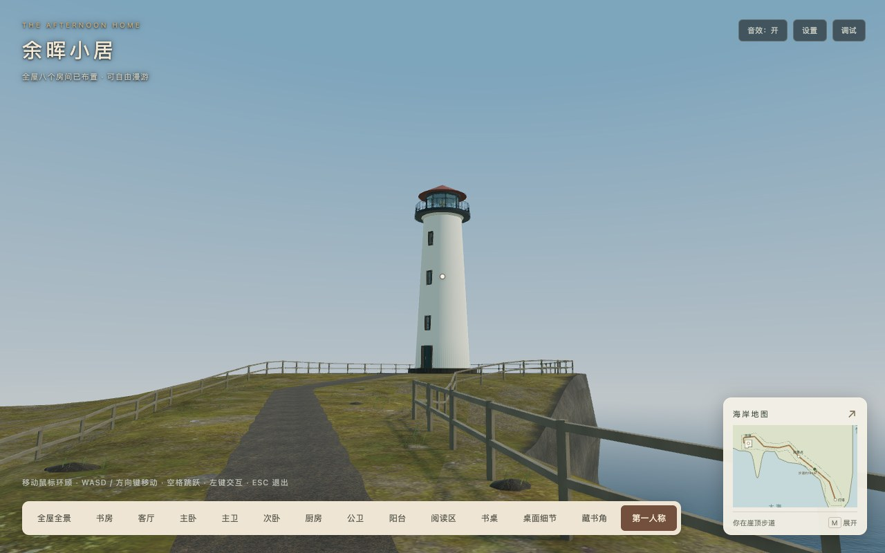
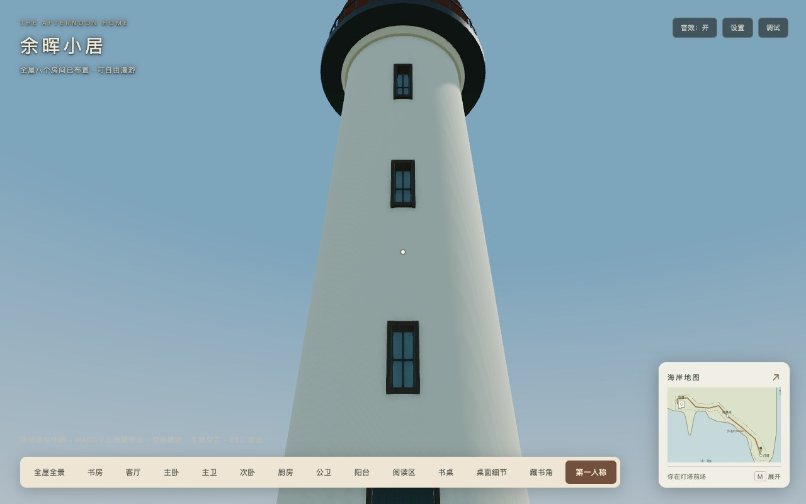
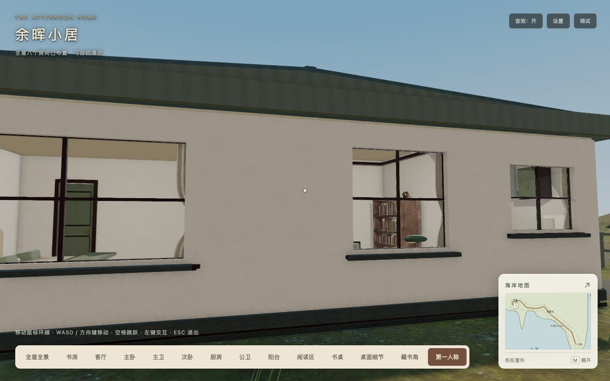
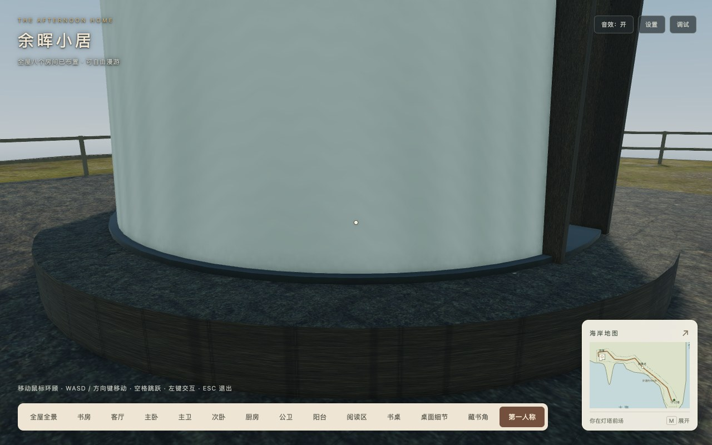

# 灯塔阶段C视觉完成验收

2026-10-18，基于`6d7e644`完成阶段C。延续阶段B的194.07米路线与有限室外漫游，灯塔内部、登塔、夜景光束和独立小电驴方案未实现；阶段D最终平台/稳定快照交付仍待后续。

## 实际改动与取舍

- 20米灯塔采用原创64段收分塔身，闭门和三个窄窗都有真实几何开口、凹进的背板/窗玻璃及厚窗套；石基/门前两级踏步保持在实体塔基阻挡内。八角玻璃灯室有内部金属灯具与黄铜灯芯，外圈检修栏杆和暗红塔帽保留远方轮廓。无白天光束、塔门交互或塔内支撑。
- 暖白灰泥的轻微盐渍、木护栏/板条长椅、铺石接缝与屋面立缝使用带屏幕导数过滤的世界坐标材质。道路/石基复用现有海岸岩石颜色/法线/ARM，不下载新图片或模型；原室内HDR/材料/日光和后期保留。路面外肩在原1.8米净宽之外小幅不规则变化，支撑与渲染仍读取同一三角形。
- 增加屋后与观景点箭头路牌、三块沿路草石；小石顶部低于普通跨步高度，主路、平台与长椅周围避让。原近宅散布种子与既有大石障碍不改。
- 屋顶由单一占位板改为低坡金属屋面/屋脊、檐边和山墙面，六窗外窗台及墙脚带保持真实门窗洞。屋面与室内天花有间距，窗台低于窗洞底面；封闭第一人称/海岸视图显示，全屋/室内剖面统一隐藏。没有整块替换室内墙材质。
- 同材质塔体/石件/金属构件合批。只有细窗棂/门板筋及小把手使用75米阈值±10米滞回；塔身/灯室/外圈栏杆/路面/碰撞始终存在。草石分块剔除。
- 保留一个1024² PCF缓存目标，近宅/沿路/塔区采用重叠局部覆盖和6米选择滞回。更换覆盖或细节显隐时刷新，静止不刷新、后台/隐藏不重定位；外景销毁同时移除新增observer。新建筑使用独立材质，不继承近宅剖切；原512²岸线/水深场、泡沫、海面及崖壁几何未改。

首次浏览器近景检查发现塔身三角面绕序与左手系法线不一致，表现为黑色斑纹和错误背面。已反转绕序，新增向外绕序/真实开口射线断言，保留原SSAO与日光阴影。另在斜视检查中发现曲面自阴影条带，将途中/塔区的depth/normal bias从0.00015/0.045调至0.001/0.25世界单位；近宅区仍用原值，返回时恢复。两种修复分别处理面朝向与宽局部视锥的采样偏移，没有关闭效果。石材亮度按既有岩材颜色解释校准。临时探针不作为最终验收证据。

## 检查与平台

- [工程日志](tests.log)：139项测试、[类型检查](typecheck.log)、[临时目录开发构建](development-build.log)、[生产构建及发布校验](production-build.log)通过。新增保护真实门窗开口/面绕序、全屋顶显隐与剖切隔离、共享贴图、阴影滞回/静止缓存/后台门控/销毁；保留原B支撑、家具和边界检查。生产构建保留三类既有Webpack体积/分包建议告警。
- [固定视角与沿路采样](visuals.json)：13个屋外/途中/塔前视角及47个路线样本；检查门窗/屋檐、基座接地、远近塔体、路肩、草石、海岸/泡沫连续性。相机单点和沿路采样是画面参考，不代替真实键盘行走。近/远细节均覆盖，同一阴影纹理保持，静止20帧阴影刷新0次。
- [浏览器矩阵](engines/matrix.json)：Chrome155与Playwright WebKit26.5，各1280×800、390×844、844×390及DPR1/2，共12组。除了海岸全景、家门支撑和大小地图，还逐组检查近景塔身/玻璃灯室/道路shader就绪及阴影目标。Chrome六组合指针锁定与按键移动通过；WebKit未获得锁定，近景使用相机画面夹具，完整键盘漫游未验。不作为Safari或物理手机验收。
- [原交互回归](regression/browser.json)：八抽屉/八灯、七单开门和阳台推拉门、55段室内路线、信件/地图、设置、拖动缩放与Inspector通过；故意缺失书架时其余房间/壳体保留。重复销毁后网格/材质/灯/引擎场景均为0。
- [主卫镜面](mirrors/master/mirror-map.json)、[公卫镜面](mirrors/public/public-mirror.json)：隐藏真实洁具使像素变化、恢复后摘要一致；门灯/其他视角与刷新门控通过，镜面目标仍为512²。
- [长帧边界](edge-cases.json)：0.25×/1.00×/3.00×与0.2秒参考步长的15组起跳/障碍检查，以及床/沙发/茶几走下、地图冻结/恢复通过。这些参考步长不计作FPS或旅行耗时测量。
- [材质失败降级](faults.json)：主动中断岩石颜色图与室外HDR两条URL，HDR发生额外重试（共5次预期失败请求）。新增道路/铺石解除失败贴图引用，塔身shader、实际地面/海岸地图保留，室内环境仍为原HDR。预期网络错误单列，无shader异常；正常最终用例无运行/着色器错误、警告或404。

[真实键盘全程往返](browser.json)通过：去程163.43秒、绕塔28.49秒、返回163.01秒，无穿地/悬空/越界；地图/设置暂停、预设恢复、主动回家、室外起跳与家具落点保留。[check-walking.cjs](check-walking.cjs)使用真实W键和正常渲染循环，只引导转向，途中不设置人物位置；独立单点夹具与正常旅行区分。本机自动转向结果仅用于体验长度，不代表所有设备的旅行时间或性能收益。

完整往返使用最终几何合批/道路支撑/输入版本，随后末次仅校准室外阴影偏移，未改通行逻辑与几何；最终偏移的画面、原交互、双引擎与发布请求另行复验。真实往返的原始请求记录保留该候选字节，不用其替代下表最终首屏统计。

Firefox、Safari和物理移动设备本轮未验。亮屏FPS、GPU耗时、峰值显存和加载耗时实验继续暂停，本轮不宣称性能提速。

## 字节、几何与绘制

[完整发布清单](release-manifest.json)、[初始依赖](bundle-analysis.json)、[发布校验](release-check.json)保留最终交付数值。36个运行素材/两目标GLB的摘要与B及原海岸基线一致；无新增下载素材、依赖、纹理对象、灯、相机或阴影/海面反射目标。

| 指标 | 阶段B历史验收 | 阶段C | 增量 / 硬预算 |
| --- | ---: | ---: | --- |
| 两目标GLB | 4,332,840字节 | 4,332,840字节 | 不变 / 4.25MiB |
| 运行素材 | 15,867,631字节 | 15,867,631字节 | 不变 / 16MiB |
| 静态初始JS | 2,606,600字节 | 2,617,031字节 | +10,431 / 3MiB |
| 实际首屏JS（含必需异步/音频预热） | 2,825,452字节 | 2,835,883字节，12JS（2.70MiB） | +10,431 / 3MiB |
| 完整发布目录 | 42,226,804字节 | 42,238,926字节，495文件（40.28MiB） | +12,122 / 41MiB |

场景640网格/559,760顶点/90材质/147纹理/16灯/3相机，较B净增11网格/12,194顶点/6材质。室外45网格/153,852顶点，低于160,000顶点目标；岸线生成纹理仍1MiB，没有增量。新增程序几何/材质有CPU/显存成本，不能因没有下载素材视作免费。

绘制对照用独立恢复`6d7e644`源码重建生产基线，相关[重建日志](before/rebuild.log)与[主通道基线](before/main-draws.json)单独保留；该重建只用于同条件绘制对照，不覆盖B历史字节测量。两版均为Chrome、1280×800、DPR1和同姿态；通过场景主绘制阶段门控统计外景网格，不混入镜面/阴影RTT及后期。

| 视角 | B外景主绘制 | C外景主绘制 | 增量 |
| --- | ---: | ---: | ---: |
| 家门外 | 22 | 30 | +8 |
| 房屋北面 | 17 | 21 | +4 |
| 途中望塔 | 28 | 35 | +7 |
| 观景点回望 | 21 | 29 | +8 |
| 塔前回望 | 28 | 40 | +12 |
| 岬角望塔 | 17 | 24 | +7 |

[最终主通道记录](main-draws.json)最大增量12，低于候选20目标。原[全帧计数](visuals.json)包含室内、镜面与后期，同姿态增量最高23，不应与主通道混用；两种计数均不代表FPS或GPU耗时。

## 独立发布与复现

仅托管最终`dist`。根路径与`/home/`各495文件GET/字节/SHA256通过，包含全部动态分包、来源、许可和清单；白名单外文件404，没有public回退。[子路径实际页面](subpath.json)的冷启动、户外定位/回家、地图暂停和Inspector动态分包通过，实际首屏字节同根路径。

- 工程：`npm test`、`npm run typecheck`、`npm run build -- --output-path /tmp/babylon-lighthouse-c-development`、`npm run build:production`。
- 生产服务：`python3 docs/technical-plans/assets/coastal-cliff-d-2026-10-18/serve-dist.py --port 8173`。
- 浏览器：设置`PLAYWRIGHT_PACKAGE`为已有Playwright、`STUDY_URL`为生产地址；运行本目录`check-visuals.cjs`、`check-walking.cjs`、`check-regression.cjs`、`check-engines.cjs`、两镜面脚本、`check-edge-cases.cjs`、`check-faults.cjs`、`check-subpath.cjs`、`check-release.cjs`。矩阵使用本机已有WebKit时另设`PLAYWRIGHT_BROWSERS_PATH`。回归/镜面输出通过`STUDY_CHECK_OUTPUT`指定独立子目录。
- 绘制：`check-main-draws.cjs`分别指向恢复源码的独立生产基线和最终页面，`DRAW_RECORD=before/main-draws.json`保存基线；不修改托管JS或依赖图。
- `browser-harness.cjs`沿用B的调试暂停，只读取现有RoomScene用于独立起点/姿态夹具，不替换生产JS；源码摘要与本轮验收汇总见`acceptance.json`。A/B与海岸v1历史记录、清单和标签均未覆盖。

## 画面

