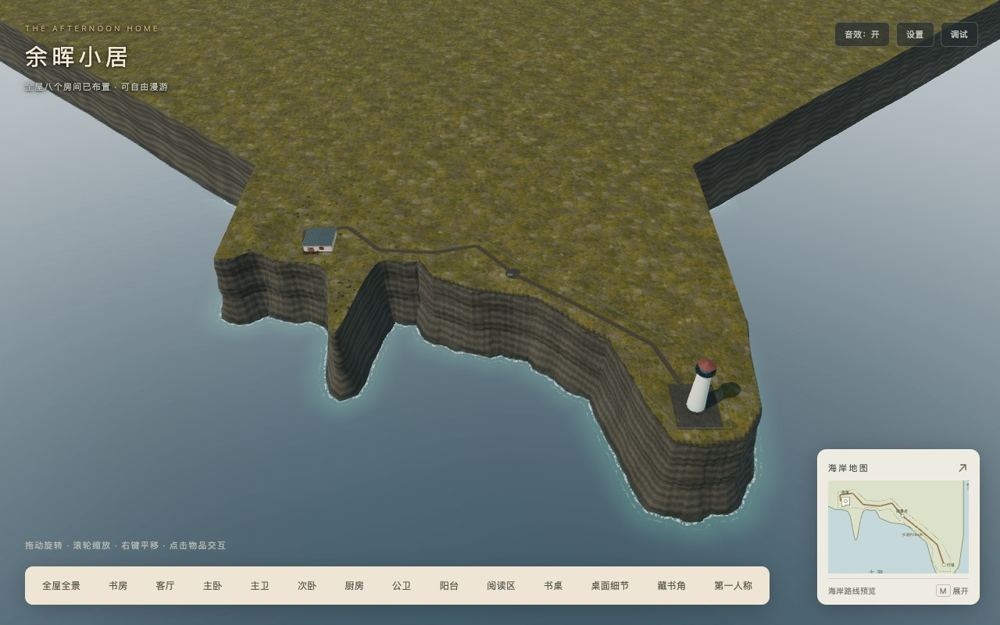
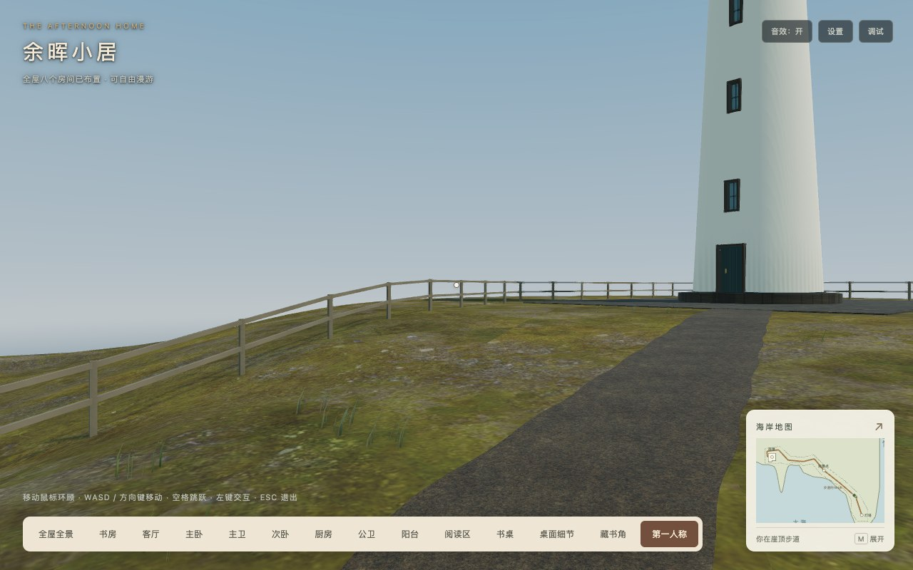

# 灯塔阶段D工程交付与稳定快照验收

日期：2026-10-18。对应[灯塔方案](../../2026-10-18-lighthouse-coastal-path.md)7.5。本轮完成D工程与当前可用环境交付；Firefox/Safari/物理设备仍未验，不将环境不可用计作通过。运行冻结点为`2581be579f8042c0b7d74b214011f38d4b6c10e8`，包含[C最终视觉](../lighthouse-c-2026-10-18/README.md)和[入户门外开](../entry-outward-2026-10-18/README.md)。本轮仅增加文档、快照元数据及验收脚本/证据，运行源码、素材、依赖和发布配置未改。

## 1. 工程与生产发布

```sh
npm test
npm run typecheck
npm run build -- --output-path /tmp/babylon-lighthouse-d-development
npm run build:production
```

141项测试、类型、开发/生产构建及自动发布校验通过；构建仍有三条Webpack体积建议告警。原始结果见[测试](tests.log)、[类型](typecheck.log)、[开发构建](development-build.log)、[生产构建](production-build.log)。最终[495文件发布清单](release-manifest.json)与入户门外开修正后的清单深度相等，36运行素材摘要不变；D没有新增下载/GPU资源或字节优化收益。

| 指标 | 当前值 | 约束 |
| --- | ---: | ---: |
| 两个目标GLB | 4,332,840字节（4.13MiB） | ≤4.25MiB |
| 36运行素材 | 15,867,631字节（15.13MiB） | ≤16MiB |
| 静态初始JS | 2,617,355字节 | ≤3MiB |
| 浏览器实际首屏JS，含必需异步/音频模块 | 2,836,207字节（12JS，2.70MiB） | ≤3MiB |
| 完整495文件发布 | 42,239,250字节（40.28MiB） | ≤41MiB |
| 场景 | 640网格 / 559,760顶点 / 90材质 / 147纹理 / 16灯 / 3相机 | 与交付基线一致 |
| 室外几何 | 45网格 / 153,852顶点 | ≤160,000顶点 |

[依赖分析](bundle-analysis.json)及[发布核对](release-check.json)保留完整分包、许可、来源和清单自身。只托管最终`dist`，没有`public`回退；根路径及`/home/`各495文件GET/字节/SHA256通过，非白名单路径404。浏览器首次Inspector及子路径入口通过，见[subpath.json](subpath.json)和[原交互请求](regression/browser.json)。测试服务器使用旧D的[只读托管脚本](../coastal-cliff-d-2026-10-18/serve-dist.py)，本轮端口8176。

## 2. 场景、连续通行与室内回归

- [固定画面/47路线采样](visuals.json)：13个视角覆盖近宅四面/屋顶、沿岸/观景点、塔前/门窗/基座/灯室/海侧、海岸全景；地面支撑、着色器、阴影位置与细节显隐通过。静止20帧阴影刷新0次，同一1024²纹理复用；512²岸线场为1,048,576字节（无mip），没有新增RTT。
- [真实输入往返](browser.json)：正常渲染循环与实际W键，脚本只引导相机方向，途中不赋位置/传送。去程163.53秒、绕塔28.48秒、返回163.04秒；保存697个位置/地面/阴影区域/细节状态样本与23张切换截图。时间用于描述路线可通行，不是FPS或加载性能指标。地图位置/朝向、预设返回、主动回家、室外跳跃/家具落点、窗/阳台/崖缘/塔基阻挡和销毁通过。
- [外开门](entry/browser.json)：门向东侧屋外开90度，双向真实键盘通行、关闭阻挡、门外遇人暂停/离开恢复及三视口地图符号/裁切通过。[门外画面](entry/entry-open-outside.jpg)、[暂停保护](entry/entry-sweep-paused.jpg)。
- [原室内回归](regression/browser.json)：8抽屉、8灯、7扇铰链门与推拉门、55段全屋路线、物品/信件/地图/设置、轨道缩放、Inspector、缺书架隔离与重复销毁通过。两卫512²镜面真实像素隐藏/恢复相等，见[主卫](mirrors/master/mirror-map.json)和[公卫](mirrors/public/public-mirror.json)。
- [15组长帧边界](edge-cases.json)：0.2秒帧、0.25/1/3速度倍率的窗/栏杆/崖缘/塔基阻挡、家具走下与地图空中暂停通过。[故障降级](faults.json)仅主动中止岩石颜色/HDR两个URL（含重试共5次失败请求）；记录预期网络错误，地图/支撑/灯塔着色器和室内HDR隔离通过。正常套件无运行/着色器错误、警告或404。
- [主通道绘制](main-draws.json)保留相同姿态的室外主绘制数；D未改运行资源，增量为0。不要将总通道统计混作主通道，也不将绘制数推断为FPS收益。





## 3. 平台与生命周期

[Chrome155/WebKit26.5矩阵](engines/matrix.json)：1280×800、390×844、844×390，各DPR1/2，共12组合；全景、塔体/玻璃/道路近景着色器、海面/岸线、地图/支撑、显隐恢复和销毁通过。Chrome六组合包含真实指针锁定/键盘检查；WebKit没有建立指针锁定，其镜头/支撑检查不等于完整键盘漫游，也不等于Safari或物理手机。

[生命周期专项](lifecycle.json)：在生产Scene内两次独立创建/销毁室外资源，45网格/17材质/9纹理/1灯及2个before-render观察者均回到原值，重复dispose安全；全页重复pagehide后网格/材质/纹理/灯/引擎Scene均为0。显隐专项用合成`document.hidden`与visibility事件，隐藏时海面时间/阴影区不变，恢复无累计时间跳变且重定位仍使用原阴影纹理；不替代操作系统真实后台测试。

[本轮平台探测](platform-availability.json)与[日志](platforms.log)：Firefox启动15秒超时，输出sandbox扩展失败与SWGL framebuffer错误；Safari已启动临时safaridriver，但会话请求20秒超时。均未建立测试会话，保持未验；未修改浏览器设置。无物理设备会话，实机移动端/听感未验。FPS、GPU耗时、峰值显存与加载耗时实验继续暂停。

## 4. 新稳定基线与恢复

[灯塔海岸v1复用入口](../../../reuse/lighthouse-coast-v1.md)、[资产/迁移边界](../../../reuse/lighthouse-asset-inventory.json)、[机器基线](../../../reuse/baselines/2026-10-18-lighthouse-coast-v1.json)共同冻结146输入、36素材和完整495发布文件。源码标签`scene-baseline/2026-10-18-lighthouse-coast-v1`指向`2581be5`，D准备提交通过本文件Git历史关联；运行元数据保留原`lighthouse-visual-c-v1 / stage C`，D是交付阶段，没有为改标识重新打包运行代码。

- [当前目录/归档校验](baseline-verification.json)：146输入/36素材/495文件及归档摘要通过。
- [独立源码克隆校验](source-restore-verification.json)：标签提交/树与输入摘要通过；[恢复说明](source-restore-notes.json)如实保留macOS大小写冲突的旧示例（不属白名单）限制。
- [恢复目录生产重建](source-rebuild-comparison.json)：使用现有锁定依赖的目录内副本（未重新联网`npm ci`），[构建通过](source-rebuild-local-dependencies.log)，[495文件逐字节通过](source-rebuild-verification.json)。先前外部`node_modules`符号链接使Webpack依赖路径变长、分包编号变化，静态初始+43字节、完整发布+18,516字节；[该次日志](source-rebuild.log)保留。换成本地依赖后完全一致，没有修改源码/配置来隐藏差异。
- [归档信息](archive.json)：确定性gzip/USTAR，本机21,460,730字节，SHA256 `470d41c17c73dafb949c9feb9f803c21a62a67c531161d482fd09bbd14ed423e`；[独立解包校验](archive-restore-verification.json)通过495文件精确集合/摘要。
- [旧版保留核验](legacy-preserved.json)：原森林v1/海岸v1四份清单及两个标签保持原值；未改默认校验目标。

二进制归档保存在`artifacts/reuse-baselines/`，不进入Git或运行白名单。源码标签/准备提交/摘要推送远端；异地二进制备份未配置，不能将推送元数据写成异地归档成功。三项历史素材保留`unverified`。通用SDK、独立小电驴、塔内/登塔、夜景灯束及海滩支路不在本轮。

## 5. 证据复跑

浏览器脚本读取`STUDY_URL`（本轮`http://127.0.0.1:8176/`）、`PLAYWRIGHT_PACKAGE`及`PLAYWRIGHT_BROWSERS_PATH`；`check-regression.cjs`还需指定`STUDY_CHECK_OUTPUT`到独立目录。Chrome使用本机应用，WebKit使用安装的Playwright引擎。`browser-harness.cjs`只用CDP在setter处暴露已加载对象，未修改托管产物；少量固定镜头/长帧用例通过对象测试，真实W键往返独立记录。

`check-visuals`、`check-walking`、`check-engines`、`check-entry`、`check-regression`、两镜面、`check-edge-cases`、`check-faults`、`check-main-draws`、`check-lifecycle`、`check-subpath`、`check-release`和`check-platforms`为本轮脚本，结果与图片同目录。`capture-baseline.cjs`和`archive-release.py`只供创建新身份，拒绝覆盖既有快照；冻结后使用只读校验器，不重写基线来消除差异。工程日志仅去除行尾空格和多余文件尾空行，保留告警/失败内容。
