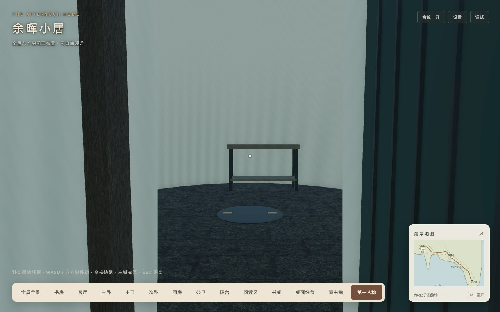
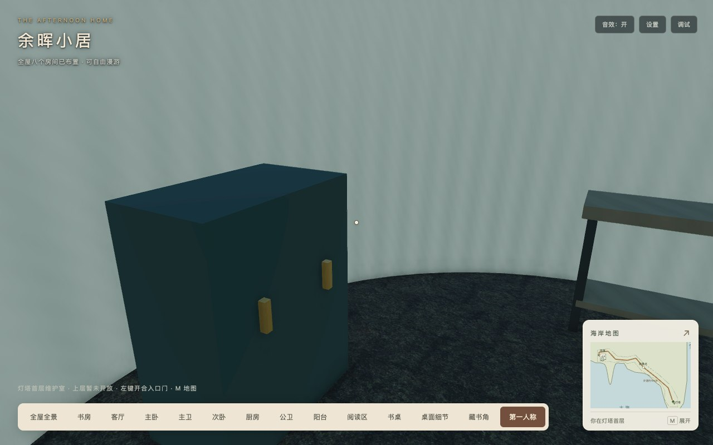

# 灯塔内部第一阶段：结构与首层开放

2026-10-18，实施基线`a4c1f14`、实现提交`b6116c0`，对应[内部结构与分期方案](../../2026-10-18-lighthouse-interior.md)。本轮完成第一阶段；螺旋梯、分层登塔和灯室/外廊仍为第二、三阶段待实施。

## 使用与结构

从家门步行或骑小电驴到灯塔前场，在塔外停车。走到灯塔北侧门前，用第一人称左键打开入口门，沿两级台阶进入首层维护室；可从里面关门、重新开门和走回前场。维护柜、工作台与中心检修盖完成基础布置，地图定位为“灯塔首层”，底部帮助与地图注明上层暂未开放。

[平面与纵向分层示意](interior-layout.svg)说明首层、预留螺旋梯和后续三处休息/检查平台的关系。现有收分塔身外径5.6米，新增0.28米内衬和真实洞口侧面，内向表面与门窗孔由同一外壳派生；首层地面相对住宅+3.54米，净高3.8米，真实顶板封闭上层。门内侧净入口与人物半径留出通行空间；塔基其他方向、墙面/窗、柜台禁止穿越，小电驴保持完整塔基禁入。

## 工程与资源

[153项测试](tests.log)、[类型检查](typecheck.log)、[临时开发构建](development-build.log)、[生产构建与自动发布校验](production-build.log)通过。工程日志只规范行尾空白，保留Webpack三类既有体积建议告警；pure导入、显式注册、资源白名单与依赖不变。

| 指标 | 实测 | 相对调参后基线 / 预算 |
| --- | ---: | --- |
| 两目标GLB | 4,332,840字节 | 不变 / ≤4.25MiB |
| 36运行素材 | 15,867,631字节 | 不变 / ≤16MiB |
| 静态初始JS | 2,637,534字节 | +5,523 / ≤3MiB |
| 实际首屏JS，含必需异步和音频模块 | 2,856,386字节（12个JS） | +5,523 / ≤3MiB |
| 完整发布目录 | 42,260,009字节，495文件 | +5,811 / ≤41MiB |
| 整体场景 | 657网格 / 565,555顶点 / 92材质 / 147纹理 / 16灯 / 3相机 | +10网格 / +1,997顶点，其余不变 |

新增塔内/入口结构12网格、2,531顶点，同时替换原封板/台阶等534顶点，净增1,997顶点；保留旧外景153,318顶点，加塔内后155,849顶点，再加既有载具3,798顶点，共159,647顶点，仍低于原160,000设计目标。新增2个门层级节点由海岸共享所有者释放；静态按材质合批，门板/筋/把手合为3个移动网格，不冻结，保留碰撞和双面拾取。

全部材质复用海岸所有者管理的PBR/环境/日光，新增几何为项目原创，无新增素材下载、材质、纹理、灯、相机或RTT；既有来源和授权核实状态不变。移动门不进入静态缓存投影，以原SSAO描述接触，不为门动画重绘整张室外阴影。首层本轮使用环境反射照明；独立室内灯、细陈设和磨损留待第三阶段，不宣称已完成精细室内表现。

## 浏览器与独立托管

[生产浏览器记录](browser.json)与[脚本](check-interior.cjs)：Chrome155.0.8059.82，未修改生产包。独立起点夹具之后，实际按W穿过台阶/门洞进出；逐步检查脚底支撑，闭门从内外阻挡，门扫掠遇人暂停/移开恢复，跳跃回落、地图暂停与首层定位、海岸预设再返回的原位恢复通过。[横屏](inside-exit-landscape.jpg)与[竖屏](inside-exit-portrait.jpg)保存真实首层出口画面。输入专项采用50ms参考步长，不能作为旅行时间、FPS或加载耗时实验。

[Chrome/WebKit矩阵](engines/matrix.json)：1280×800、390×844、844×390，各DPR1/2，12组合检查内外几何/材质、无新增纹理灯相机、显隐与重复销毁；WebKit为26.5，明确使用本机已安装`webkit-2336/pw_run.sh`，不以默认Playwright期望的其他修订代替。矩阵是镜头夹具，实际指针锁定/键盘进出仅计Chrome。hardware scaling仍为1，DPR截图不代表增加画布分辨率。

截图QA发现停渲染后切换视口会采到画布清空帧，已在截图期间恢复正常渲染并等待视口合成稳定，重新采集与检查，并用[空白采集检查](screenshot-qa.json)确认24张矩阵截图的场景区域均非纯色；这属于采集时序修正，运行代码没有为截图增加分支。验收JSON和最终截图均来自上述最终生产包。

[原房屋交互回归](regression/browser.json)通过8抽屉、8灯、7铰链门/推拉门、55段室内连续路线、地图/信件/设置、缩放、Inspector、家具缺失降级与销毁；25个旧交互加灯塔门共26个。新门根节点与网格所有权检查通过。[主卫镜面](mirrors/master/mirror-map.json)与[公卫镜面](mirrors/public/public-mirror.json)另行检查真实动态像素隐藏/恢复；其baseline字段为复用套件来源，本轮URL指向本发布包。

[发布核验](release-check.json)、[清单](release-manifest.json)和[依赖分析](bundle-analysis.json)保留全部动态分包、说明与清单自身。只托管`dist`，根路径和`/home/`各495个文件GET/字节/SHA256通过；无`public`回退，36素材摘要不变。[子路径记录](subpath.json)验证实际首屏JS同为2,856,386字节，地图与按需Inspector可用、所有JS来自`/home/`。正常套件无页面/着色器错误、警告或4xx；故意缺家具的预期网络失败由回归套件单列。

## 边界和复跑

第二阶段还需实现高度感知支撑、螺旋梯/扶手/平台、灯室出口与外廊净宽验收。第一阶段的检修盖不可打开，维护柜和工作台暂无交互；它们不是未登记的最终精细陈设。Firefox/Safari、物理设备及WebKit完整键盘漫游未验，FPS/GPU/总显存峰值/加载耗时实验继续暂停。

浏览器脚本读取`STUDY_URL`、`PLAYWRIGHT_PACKAGE`；矩阵可通过`PLAYWRIGHT_WEBKIT_EXECUTABLE`选择已安装WebKit启动脚本。本机本轮使用`/tmp/dsh-playwright/node_modules/playwright-core`与`/tmp/study-audio-test-browsers/webkit-2336/pw_run.sh`。托管脚本复用[生产目录服务器](../coastal-cliff-d-2026-10-18/serve-dist.py)，端口8182。原房屋回归由小电驴套件复制，只将交互总数由25改为26；原镜面套件通过`STUDY_CHECK_OUTPUT`保存到本目录，不覆盖历史证据。
